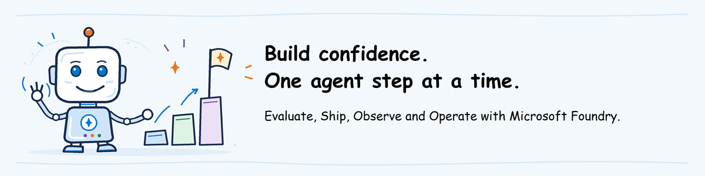

# AgentOps Value Based Delivery guide

## Overview

AgentOps is the discipline of evaluating, releasing, observing, and operating AI
agents through repeatable practices. It connects quality evidence, release
controls, runtime visibility, operational response, and continuous improvement
across the agent lifecycle. This material applies AgentOps to Microsoft Foundry
agents.

The AgentOps Value Based Delivery is part of the AI Governance Value Based
Delivery offering. It has two components:

- **Workshop:** builds shared understanding through a one-pager, decks, and
  hands-on labs.
- **Implementation guidance:** helps teams establish the AgentOps practices in a
  target environment.

## Start here

| Your goal | Start with |
| --- | --- |
| Understand what the workshop delivers | [Workshop one-pager](workshop/one-pager/agentops-vbd-one-pager.pdf) |
| Prepare and teach a module | [Instructor guide](workshop/instructor-guide/README.md): understand the lesson, reuse or prepare the environment, rehearse, then teach |
| Participate in the workshop | [Lab sequence](workshop/labs/README.md): complete your pre-work, then open the selected numbered lab |
| Apply the practices in your organization | [Implementation guidance](implementation-guidance/) |

## Practices and modules

AgentOps covers four practices organized into three content modules. Observe and
Operate remain distinct practices but are delivered together.

| Practice | Content module | Focus |
| --- | --- | --- |
| Evaluate | Evaluate | Define and maintain evidence of agent quality, safety, behavior, and outcomes |
| Ship | Ship | Release evaluated agents through controlled and repeatable processes |
| Observe | Observe and Operate | Understand agent behavior, quality, reliability, performance, and usage |
| Operate | Observe and Operate | Respond to issues, maintain the service, and improve it over time |

**Supporting tooling:** [AgentOps Accelerator](https://aka.ms/agentops-accelerator)
is an open-source reference for evaluation, safety testing, observability and
release checks. It supports the Microsoft Foundry activities in this VBD;
it is not the platform itself.

## Folder map

Paths below are relative to `agentops`.

| Folder | What belongs here |
| --- | --- |
| [`workshop/one-pager`](workshop/one-pager/) | Overview for participants, outcomes, scope and formats |
| [`workshop/instructor-guide`](workshop/instructor-guide/README.md) | Reading order, preparation route and facilitation |
| [`workshop/pre-work`](workshop/pre-work/README.md) | Participant setup and separately identified instructor/admin preparation |
| [`workshop/decks`](workshop/decks/) | Presentations and speaker notes for the three modules |
| [`workshop/labs`](workshop/labs/README.md) | `01-evaluate`, `02-ship`, `03-observe-operate`, then optional `04-advanced` |
| [`workshop/labs/shared`](workshop/labs/shared/) | Reusable help desk agent code and supporting files, not another lab |
| [`workshop/assets`](workshop/assets/) | Shared workshop illustrations and their sources |
| [`implementation-guidance`](implementation-guidance/) | Organizational adoption guidance, separate from the workshop |

Lab numbers show the recommended sequence, not mandatory prior attendance.
The instructor supplies earlier-module results for standalone delivery.
Agent deployment is instructor/admin pre-work; participants use the prepared
class environment. Ship offers alternative
[GitHub Actions](workshop/labs/02-ship/github-actions/README.md) and
[Azure Pipelines](workshop/labs/02-ship/azure-pipelines/README.md) paths.
Complete one, not both.

## Materials

| Component | Module | Location |
| --- | --- | --- |
| Workshop one-pager | Overview for participants, outcomes, scope and formats | [One-page PDF](workshop/one-pager/agentops-vbd-one-pager.pdf), [Markdown source](workshop/one-pager/agentops-vbd-one-pager.md) |
| Workshop instructor guide | Start here, prepare and facilitate each module | [General guide](workshop/instructor-guide/README.md), [Evaluate](workshop/instructor-guide/evaluate.md), [Ship](workshop/instructor-guide/ship.md), [Observe and Operate](workshop/instructor-guide/observe-operate.md) |
| Workshop lab sequence | Participant starting page with links to pre-work, numbered labs and the alternative Ship pipeline tools | [Workshop labs](workshop/labs/README.md) |
| Workshop deck | Evaluate | [`agentops-evaluate-workshop.pptx`](workshop/decks/evaluate/agentops-evaluate-workshop.pptx) |
| Workshop lab | Evaluate participant actions and decision | [`lab.md`](workshop/labs/01-evaluate/lab.md) |
| Workshop pre-work | Essential participant setup and technical class preparation | [Participants start here](workshop/pre-work/README.md), [technical setup](workshop/pre-work/technical-setup.md) |
| Foundry environment setup | Create or reuse the project, deploy models and arrange access | [Instructor/admin environment steps](workshop/pre-work/foundry-environment.md) |
| Hosted agent setup | Create/update course versions; local debugging is optional | [Help desk deployment](workshop/labs/shared/helpdesk-agent/README.md) |
| Evaluation tooling | Evaluate versions, rationale, capability boundaries and authoring status | [Tooling notes](workshop/labs/01-evaluate/TOOLING.md), [pinned dependencies](workshop/labs/01-evaluate/requirements.txt) |
| Evaluation workflow | Evaluate | [Public Accelerator CLI config](workshop/labs/01-evaluate/assets/agentops.yaml), [offline public CLI tests](workshop/labs/01-evaluate/scripts/test_public_cli.py) |
| Evaluation inputs | Evaluate | [Turn cases](workshop/labs/01-evaluate/assets/turns.jsonl) |
| Evaluation assignment and evidence | Evaluate | [Receive the prepared workspace](workshop/pre-work/README.md#2-participant-initialize-the-supported-evaluation-workspace), [technical setup](workshop/pre-work/technical-setup.md#instructoradmin-prepare-the-evaluation-workspace), [closing discussion](workshop/labs/01-evaluate/lab.md#6-record-the-decision), [required instructor evidence](workshop/labs/01-evaluate/assets/evidence/README.md) |
| Workshop deck | Ship | [`agentops-ship-workshop.pptx`](workshop/decks/ship/agentops-ship-workshop.pptx) |
| Workshop lab | Ship | [`lab.md`](workshop/labs/02-ship/lab.md) |
| Ship pipeline tools | Choose one alternative | [GitHub Actions](workshop/labs/02-ship/github-actions/README.md), [Azure Pipelines](workshop/labs/02-ship/azure-pipelines/README.md) |
| Workshop deck | Observe and Operate | [`agentops-observe-operate-workshop.pptx`](workshop/decks/observe-operate/agentops-observe-operate-workshop.pptx) |
| Workshop lab | Observe and Operate | [`lab.md`](workshop/labs/03-observe-operate/lab.md) |
| Optional advanced lab | Cross-module | [`lab.md`](workshop/labs/04-advanced/lab.md) |
| Workshop illustrations | Guide openings and key steps | [Banner artwork, editable sources and generator](workshop/assets/banners/README.md) |
| Implementation guidance | Evaluate | [`implementation-guidance/evaluate.md`](implementation-guidance/evaluate.md) |
| Implementation guidance | Ship | [`implementation-guidance/ship.md`](implementation-guidance/ship.md) |
| Implementation guidance | Observe and Operate | [`implementation-guidance/observe-operate.md`](implementation-guidance/observe-operate.md) |

The source is [placerda/AzureAIGovernance](https://github.com/placerda/AzureAIGovernance).
Instructors follow [source download](workshop/pre-work/technical-setup.md#a-download-the-workshop-source-and-open-powershell)
and [session distribution](workshop/pre-work/technical-setup.md#publish-the-workshop-files-and-invitation).
Evaluate participants clone this repository and run both evaluations
themselves in a shared Foundry project, using the **Evaluate settings** from the
**AgentOps workshop** invitation. In Ship, the instructor prepares one class
repository and each participant builds their own pipeline in it. Observe and
Operate and Advanced continue with the participant's own agent and pipeline.

In Evaluate, participants test an agent running in Microsoft Foundry and read
its answers, tool results and scores. The Accelerator CLI submits the requests
and checks average scores. Additional Foundry results cover support-quality
rules, safety, conversations and adversarial tests.
Use [final check before the workshop](workshop/pre-work/technical-setup.md#final-check-before-the-workshop)
before teaching.

Ship has equivalent instructions for GitHub Actions and Azure Pipelines.
Evaluate uses Foundry evaluation and evaluators, with the Accelerator CLI
submitting runs against an already deployed help desk agent; learners do not
use azd in Evaluate. In Ship, participants generate a pipeline with the
Accelerator CLI that deploys with azd, evaluates, waits for approval and runs a
smoke test. Creating Azure resources stays outside workshop time.
In Observe and Operate, participants investigate an exact response and trace,
run a version-scoped query, fire an alert and retain an operational decision.
Advanced turns that same incident into a critical regression test, proves that
the release controls stop it, then retains the recovery evidence and runbook.

## Delivery sequence

1. Share the one-pager with participants and agree the modules and format with
   the workshop organizer.
2. Follow the instructor guide and audience-specific pre-work, then teach each
   selected module with its deck and lab.
3. Capture workshop decisions, evidence, gaps, and implementation priorities.
4. Use the corresponding implementation guide to establish each practice in the
   target environment.
