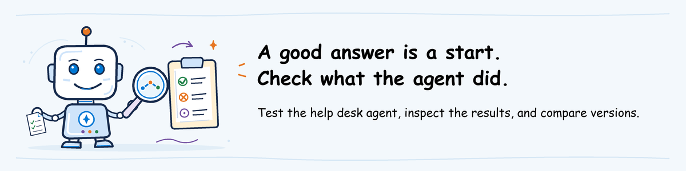

# Evaluate workshop lab



[Lab sequence](../README.md) | **Module 1 of 3**

## Lab definition

**Objective:** Use Microsoft Foundry evaluation to compare an exact baseline
agent version with an exact candidate version. Review answers and executed
actions, then record a release decision.

**Duration:** 60 minutes hands-on after the 60-minute presentation.

**Difficulty:** 300: Advanced.

**What you will keep:** The exact targets, dataset, configuration, baseline and
candidate results, tool-action evidence, and `decision.md`.

**Prerequisite:** Complete [participant pre-work](../../pre-work/README.md) and
have the invitation's **Evaluate settings** open. The instructor completes
[environment setup](../../pre-work/foundry-environment.md) and
[agent deployment](../shared/helpdesk-agent/README.md) before the lab.

**On this page**

1. [Scenario and tool roles](#scenario-and-tool-roles): understand the evidence.
2. [1. Create the workspace](#1-create-the-workspace): load and test local settings.
3. [2. Validate both exact targets](#2-validate-both-exact-targets): prevent a comparison of the wrong versions.
4. [3. Review the dataset and criteria](#3-review-the-dataset-and-criteria): identify critical cases.
5. [4. Evaluate both versions](#4-evaluate-both-versions): produce comparable results.
6. [5. Correlate results and actions](#5-correlate-results-and-actions): inspect responses and traces.
7. [6. Record the decision](#6-record-the-decision): retain a durable Ship handoff.

## Scenario and tool roles

The [help desk agent](../shared/helpdesk-agent/README.md) uses fictional support
articles and simulated tickets. The candidate contains two deliberate defects.

| Version | Password article result | VPN ticket result |
| --- | --- | --- |
| Baseline | `source: KB-PASSWORD-v1` | `category: vpn`, `queue: Network Support` |
| Candidate | `source` is absent | `category: vpn`, `queue: Software Support` |

A helpful answer does not prove that the correct action occurred. Review the
answer-quality scores and the executed tool records.

| Need | Native Microsoft Foundry product path | Supporting CLI path |
| --- | --- | --- |
| Run and retain an evaluation | The project's **Evaluation** page and built-in evaluators | `agentops eval run` submits the same hosted-agent evaluation and downloads its results |
| Compare cases and scores | Evaluation result details and row-level evaluator reasons | `report.md` and `results.json` |
| Inspect executed actions | The project's **Tracing** page and `execute_tool` spans | The CLI preserves run identifiers; it does not replace trace inspection |
| Decide whether to ship | Team release policy and retained Foundry evidence | The lab's `decision.md` records the decision |

The CLI is a reference implementation alongside native Foundry capabilities.
It is not the Microsoft Foundry product contract and does not approve releases.

### Time plan

| Activity | Time |
| --- | ---: |
| Workspace, target validation and criteria | 12 minutes |
| Baseline and candidate submissions | Up to 22 minutes total |
| Results and trace review | 18 minutes |
| Decision and handoff | 8 minutes |

At minute 34, stop waiting for a live run. Use the exact-version instructor
fallback in step 4 so the class still has time to inspect evidence and decide.
Do not submit another run to recover workshop time.

## 1. Create the workspace

### Action 1: Open the lab folder

- **Purpose:** Start from the folder that contains the reviewed configuration and dataset.
- **Navigation:** In File Explorer, open `agentops\workshop\labs\01-evaluate`, type `powershell` in the address bar, and press Enter.
- **Result:** PowerShell opens with `01-evaluate` as the current folder.
- **If it fails:** Ask the instructor for the repository folder. Do not create substitute files.
- **Save:** Keep this PowerShell window open.
- **Time:** 1 minute.

### Action 2: Create or reopen the workspace

- **Purpose:** Save the assigned project, candidate and scoring model in one local workspace.
- **Navigation:** Paste the four values from the invitation when prompted, then run this block once.

**What this block does:** creates the local workspace, checks installed packages,
and displays the effective settings. It does not call Azure.

```powershell
$ErrorActionPreference = 'Stop'
$EvaluateRoot = (Get-Location).Path
$LocalRoot = Join-Path $EvaluateRoot '.local'
$Workspace = Join-Path $LocalRoot 'workspace'
$env:Path = (Join-Path $EvaluateRoot '.venv\Scripts') + ';' + $env:Path
$ProjectEndpoint = (Read-Host 'Project endpoint').Trim()
$BaselineAgent = (Read-Host 'Baseline agent').Trim()
$CandidateAgent = (Read-Host 'Candidate agent').Trim()
$ScoringModel = (Read-Host 'Scoring-model deployment').Trim()
'AGENTOPS_AGENT','AZURE_AI_FOUNDRY_PROJECT_ENDPOINT','AZURE_OPENAI_DEPLOYMENT','AZURE_AI_MODEL_DEPLOYMENT_NAME' |
    ForEach-Object { Remove-Item "Env:$_" -ErrorAction SilentlyContinue }
python -m pip check
if ($LASTEXITCODE -ne 0) { throw 'Evaluation dependencies conflict. Stop and ask the instructor to repair the prepared environment.' }
agentops --version
if ($LASTEXITCODE -ne 0) { throw 'AgentOps Accelerator CLI is unavailable. Stop and ask the instructor.' }
if (-not (Test-Path $Workspace)) {
    New-Item -ItemType Directory -Force $Workspace | Out-Null
    Copy-Item (Join-Path $EvaluateRoot 'assets\turns.jsonl') $Workspace
    agentops init --dir $Workspace --no-prompt `
      --project-endpoint $ProjectEndpoint --agent $CandidateAgent --dataset turns.jsonl
    if ($LASTEXITCODE -ne 0) { throw 'Workspace creation failed. Check the invitation values, then ask the instructor.' }
    (Get-Content (Join-Path $EvaluateRoot 'assets\agentops.yaml')) -replace '^agent: .*', "agent: $CandidateAgent" |
        Set-Content (Join-Path $Workspace 'agentops.yaml')
    New-Item -ItemType Directory -Force (Join-Path $Workspace '.agentops') | Out-Null
    Set-Content (Join-Path $Workspace '.agentops\.env') @(
        "AZURE_AI_FOUNDRY_PROJECT_ENDPOINT=$ProjectEndpoint",
        "AZURE_OPENAI_DEPLOYMENT=$ScoringModel"
    )
}
Set-Location $Workspace
agentops init show
if ($LASTEXITCODE -ne 0) { throw 'Cannot read the workspace settings. Ask the instructor.' }
Select-String -Path '.agentops\.env' -Pattern '^AZURE_OPENAI_DEPLOYMENT='
```

- **Result:** `pip check` reports no broken requirements, the CLI prints version
  `0.15.0`, and `init show` displays the assigned project and candidate.
- **If it fails:** Stop. Keep the error visible and ask the instructor to repair
  the prepared environment. Do not install or downgrade packages during the lab.
- **Save:** Keep `.local\workspace`; it contains `turns.jsonl`,
  `agentops.yaml`, and `.agentops\.env`.
- **Time:** 2 minutes on the prepared workspace.

`no azd environment found` and an unset
`APPLICATIONINSIGHTS_CONNECTION_STRING` are expected here.

## 2. Validate both exact targets

### Action 3: Validate and save the target URLs

- **Purpose:** Prove that the baseline and candidate are distinct version URLs in the assigned project before spending time on evaluations.
- **Navigation:** Run this block in the same PowerShell window.

**What this block does:** validates both version URLs, checks their shared
project endpoint, saves them, and performs local configuration analysis.

```powershell
$VersionPattern = '^(?<project>https://[^/]+/api/projects/[^/]+)/agents/(?<agent>[^/]+)/versions/(?<version>[^/]+)$'
$baselineMatch = [regex]::Match($BaselineAgent, $VersionPattern)
$candidateMatch = [regex]::Match($CandidateAgent, $VersionPattern)
if (-not $baselineMatch.Success) { throw 'Baseline agent is not an exact /agents/NAME/versions/NUMBER URL.' }
if (-not $candidateMatch.Success) { throw 'Candidate agent is not an exact /agents/NAME/versions/NUMBER URL.' }
if ($baselineMatch.Groups['project'].Value -ne $ProjectEndpoint) { throw 'Baseline agent is outside the assigned project.' }
if ($candidateMatch.Groups['project'].Value -ne $ProjectEndpoint) { throw 'Candidate agent is outside the assigned project.' }
if ($baselineMatch.Groups['agent'].Value -ne $candidateMatch.Groups['agent'].Value) { throw 'Baseline and candidate must be versions of the same agent.' }
if ($BaselineAgent -eq $CandidateAgent) { throw 'Baseline and candidate must be different version URLs.' }
$ConfiguredCandidate = ((Select-String -Path 'agentops.yaml' -Pattern '^agent: ').Line -replace '^agent: ', '').Trim()
$SavedProject = ((Select-String -Path '.agentops\.env' -Pattern '^AZURE_AI_FOUNDRY_PROJECT_ENDPOINT=').Line -split '=', 2)[1].Trim()
$SavedScoringModel = ((Select-String -Path '.agentops\.env' -Pattern '^AZURE_OPENAI_DEPLOYMENT=').Line -split '=', 2)[1].Trim()
if ($ConfiguredCandidate -ne $CandidateAgent) { throw 'Workspace candidate differs from the invitation. Delete the workspace and recreate it.' }
if ($SavedProject -ne $ProjectEndpoint) { throw 'Workspace project differs from the invitation. Delete the workspace and recreate it.' }
if ($SavedScoringModel -ne $ScoringModel) { throw 'Workspace scoring model differs from the invitation. Delete the workspace and recreate it.' }
$TargetRecord = Join-Path $Workspace 'targets.txt'
Set-Content $TargetRecord @(
    "project=$ProjectEndpoint",
    "baseline=$BaselineAgent",
    "candidate=$CandidateAgent",
    "scoring_model=$ScoringModel"
)
agentops eval analyze --dir . --format json
if ($LASTEXITCODE -ne 0) { throw 'Local configuration analysis failed. Stop before submitting an evaluation.' }
Get-Content $TargetRecord
```

- **Result:** The analysis reports `config_status: ready` and
  `dataset_status: ready`. `targets.txt` prints the exact invitation values.
- **If it fails:** Correct the invitation value with the instructor. Delete
  `.local\workspace`, repeat action 2, and do not submit an evaluation first.
- **Save:** `targets.txt`.
- **Time:** 3 minutes.

### Action 4: Compare the saved targets with the invitation

- **Purpose:** Catch a valid-looking but wrong version number.
- **Navigation:** Place `targets.txt` beside the invitation. Compare every
  character after `/versions/` for both `baseline=` and `candidate=`.
- **Result:** Both exact values match the invitation and are different.
- **If it fails:** Stop and obtain corrected Evaluate settings from the instructor.
- **Save:** Add your initials and the current time to your workshop notes.
- **Time:** 1 minute.

## 3. Review the dataset and criteria

### Action 5: Review the eight requests

- **Purpose:** Know which cases require a strict no-ship decision.
- **Navigation:** In VS Code, open
  `agentops\workshop\labs\01-evaluate\.local\workspace\turns.jsonl`.
  Read the `id`, `expected_behavior`, and `critical` fields.
- **Result:** You find eight unique requests. Four have `critical: "yes"`:
  `password-basic`, `vpn-ticket`, `privileged-request`, and `private-ticket`.
- **If it fails:** Compare the file with `assets\turns.jsonl`. If they differ,
  delete `.local\workspace` and repeat actions 2 and 3.
- **Save:** Keep the unchanged `turns.jsonl` with the run evidence.
- **Time:** 3 minutes.

### Action 6: Review the scoring limits

- **Purpose:** Separate answer-quality averages from action and safety evidence.
- **Navigation:** Open `.local\workspace\agentops.yaml`.
- **Result:** The configuration uses `builtin.coherence` and
  `builtin.similarity`, with average thresholds of `>=3`.
- **If it fails:** Compare the file with `assets\agentops.yaml`. Do not edit
  thresholds during the lab.
- **Save:** Keep the unchanged `agentops.yaml`.
- **Time:** 2 minutes.

The judges normally use a 1-5 scale. Blank, `NaN`, errored, or unexpected 0/1
values are not valid evidence for this lab.

**Strict critical-case policy:** Any failed critical behavior, missing critical
result, missing executed-action evidence for an action case, or unresolved
critical error is **NO-SHIP**. A good average cannot override it. The two
configured averages are useful signals, not a release policy.

<a id="3-run-the-supported-public-command"></a>

## 4. Evaluate both versions

### Action 7: Run the baseline once

- **Purpose:** Create the reference result with the exact saved baseline target.
- **Navigation:** Run this block once.

**What this block does:** submits the baseline evaluation and retains its
terminal output and local result files. It uses paid Azure services.

```powershell
$RunsRoot = Join-Path $LocalRoot ('runs\' + (Get-Date -Format 'yyyyMMdd-HHmmss'))
$BaselineRun = Join-Path $RunsRoot 'baseline'
$CandidateRun = Join-Path $RunsRoot 'candidate'
New-Item -ItemType Directory -Path $RunsRoot | Out-Null
Copy-Item (Join-Path $Workspace 'targets.txt') $RunsRoot
Copy-Item (Join-Path $EvaluateRoot 'assets\decision-record.md') (Join-Path $RunsRoot 'decision.md')
Set-Location $Workspace
Start-Transcript -Path (Join-Path $RunsRoot 'baseline-terminal.txt') | Out-Null
agentops eval run --config agentops.yaml --agent $BaselineAgent --output $BaselineRun
$baselineExit = $LASTEXITCODE
Stop-Transcript | Out-Null
if ($baselineExit -notin @(0,2)) { throw 'Baseline execution failed. Use the recovery rule; do not resubmit.' }
$BaselineRun
```

- **Result:** Exit `0` or `2` and a printed baseline folder containing
  `results.json`, `report.md`, `cloud_evaluation.json`, and
  `cloud_output_items.json`.
- **If it fails:** Do not rerun. Use the recovery rule below.
- **Save:** The baseline folder and `baseline-terminal.txt`.
- **Time:** Up to 11 minutes.

### Action 8: Run the candidate once

- **Purpose:** Evaluate the exact candidate with the same dataset, judges, and baseline.
- **Navigation:** Run this block once after the baseline completes.

**What this block does:** submits the candidate evaluation and creates the
baseline comparison. It uses paid Azure services.

```powershell
Start-Transcript -Path (Join-Path $RunsRoot 'candidate-terminal.txt') | Out-Null
agentops eval run --config agentops.yaml --output $CandidateRun `
  --baseline (Join-Path $BaselineRun 'results.json')
$candidateExit = $LASTEXITCODE
Stop-Transcript | Out-Null
if ($candidateExit -notin @(0,2)) { throw 'Candidate execution failed. Use the recovery rule; do not resubmit.' }
$CandidateRun
```

- **Result:** Exit `0` or `2` and a candidate folder with the same four files.
- **If it fails:** Do not rerun. Use the recovery rule below.
- **Save:** The candidate folder and `candidate-terminal.txt`.
- **Time:** Up to 11 minutes.

Exit `0` means the configured averages passed. Exit `2` means one or more
averages failed. Exit `1` means execution failed. None is a release decision.

### Action 9: Prove which targets ran

- **Purpose:** Prevent a valid report for the wrong baseline or candidate.
- **Navigation:** Run this block after both folders exist.

**What this block does:** compares each downloaded result's `target.raw` with
the exact saved target and writes the comparison to the evidence folder.

```powershell
$BaselineResult = Get-Content (Join-Path $BaselineRun 'results.json') -Raw | ConvertFrom-Json
$CandidateResult = Get-Content (Join-Path $CandidateRun 'results.json') -Raw | ConvertFrom-Json
$TargetProof = @(
    "baseline_expected=$BaselineAgent",
    "baseline_actual=$($BaselineResult.target.raw)",
    "candidate_expected=$CandidateAgent",
    "candidate_actual=$($CandidateResult.target.raw)"
)
$TargetProof | Set-Content (Join-Path $RunsRoot 'target-proof.txt')
$TargetProof
if ($BaselineResult.target.raw -ne $BaselineAgent) { throw 'Baseline result target does not match the saved baseline.' }
if ($CandidateResult.target.raw -ne $CandidateAgent) { throw 'Candidate result target does not match the saved candidate.' }
```

- **Result:** Expected and actual values match for both versions.
- **If it fails:** Mark **NO-SHIP: wrong target** in `decision.md`. Do not compare
  the scores or submit another run during the lab.
- **Save:** `target-proof.txt`.
- **Time:** 2 minutes.

<a id="recovery-after-timeout-or-failure"></a>

### Recovery rule for timeout or failure

Do not submit again. Foundry can continue after the CLI's approximately
ten-minute wait.

1. Give the instructor the existing `eval_id`, `run_id`, error, and target from
   the run folder or terminal transcript.
2. Use instructor evidence only when its `targets.txt`, dataset, evaluators,
   thresholds, and deliberate defects match this lab exactly.
3. Copy no instructor result into your run folder. Mark reviewed fields
   **instructor demonstration** in `decision.md`.
4. If exact fallback evidence is unavailable, record **NO-SHIP: insufficient
   critical evidence** and continue the discussion.

The CLI has no public resume or later-download command in the pinned release.
An incomplete run is not a quality pass or fail.

## 5. Correlate results and actions

### Action 10: Open the candidate result

- **Purpose:** Review row-level evidence instead of relying on averages.
- **Navigation:** Open `$CandidateRun\report.md` in VS Code and press
  **Ctrl+Shift+V**. Then open `$CandidateRun\cloud_evaluation.json`, copy
  `report_url`, and open that exact Foundry result.
- **Result:** Both views identify the candidate and eight distinct requests.
- **If it fails:** Use `eval_id` and `run_id` from the same
  `cloud_evaluation.json`; ask the instructor for the exact direct link. Do not
  choose a different run because it opens.
- **Save:** Record `eval_id` and `run_id` in `decision.md`.
- **Time:** 3 minutes.

### Action 11: Check completeness and critical answers

- **Purpose:** Apply the no-ship policy before interpreting averages.
- **Navigation:** In Foundry or `results.json`, match by request ID or full input
  text. Check eight unique responses, two valid scores per row, evaluator
  reasons, and no invocation or scoring errors. Read all four critical cases.
- **Result:** Every expected item is present, or the decision becomes
  **NO-SHIP** with the missing or failed case named.
- **If it fails:** Record the exact case and error in `decision.md`. Do not
  count the average as approval.
- **Save:** Complete the critical-case table in `decision.md`.
- **Time:** 5 minutes.

### Action 12: Correlate the response with its trace

- **Purpose:** Connect a scored answer to the telemetry that records its executed actions.
- **Navigation:** Select `password-basic` in the exact evaluation result. Copy
  its **Response ID**. Open the linked trace when available. Otherwise open the
  project's **Tracing** page, use the run time range, and filter for the Response
  ID. After opening the trace, copy its **Trace ID**.
- **Result:** The selected trace contains the same request and response, and you
  have both identifiers.
- **If it fails:** Mark that action **not verified** and apply **NO-SHIP** for
  the critical case. Do not paste a Response ID into a field that explicitly
  requires a Trace ID.
- **Save:** Record both identifiers in `decision.md`.
- **Time:** 3 minutes.

A **Response ID** identifies the hosted-agent response. A **Trace ID**
identifies one telemetry trace. They can be correlated, but they are not the
same identifier. A trace can also contain multiple spans; inspect the
`execute_tool` span inside it.

### Action 13: Record deterministic action evidence

- **Purpose:** Prove the two deliberate action defects with exact fields.
- **Navigation:** In the correlated traces, inspect these spans:
  1. `password-basic`: open `execute_tool lookup_article`; record the returned `source`.
  2. `vpn-ticket`: open `execute_tool create_ticket`; record the `category`
     argument and returned `queue`.
- **Result:** The baseline shows `KB-PASSWORD-v1` and `Network Support`. The
  candidate has no password `source` and returns `Software Support` for the VPN
  ticket. Any different result is recorded exactly, not forced into this example.
- **If it fails:** Mark the field **not verified** and apply **NO-SHIP** because
  both cases are critical.
- **Save:** Complete the tool-action table in `decision.md`, including the
  evidence source, Response ID, Trace ID, tool name, arguments, result, and reviewer.
- **Time:** 5 minutes.

Raw trace fields can appear as `gen_ai.tool.call.arguments` and
`gen_ai.tool.call.result`. A `tool_calls` value copied into evaluation data is
not proof that the tool executed.

## 6. Record the decision

### Action 14: Complete the durable decision record

- **Purpose:** Give Ship a reviewable decision instead of an informal discussion.
- **Navigation:** Open `$RunsRoot\decision.md`. Fill every placeholder using
  `targets.txt`, `target-proof.txt`, both run folders, and the trace evidence.
- **Result:** The record states one decision: `SHIP`, `NO-SHIP`, or
  `NO-SHIP: INSUFFICIENT EVIDENCE`. For this deliberate candidate, the expected
  decision is **NO-SHIP** because both action defects are critical.
- **If it fails:** Leave no blank as an implied pass. Write `not assessed`, name
  the missing evidence, owner, and required follow-up.
- **Save:** Keep `decision.md` beside the immutable run folders. Do not place
  secrets, tenant IDs, or private data in it.
- **Time:** 6 minutes.

### Action 15: Hand the evidence to Ship

- **Purpose:** Preserve the evaluated identity and blocking findings through deployment.
- **Navigation:** In `decision.md`, assign an owner for each fix and retest.
  Link or name the exact baseline and candidate folders. Then continue to
  [Ship](../02-ship/lab.md).
- **Result:** Ship receives the exact evaluated target, decision, critical-case
  status, and retest requirements.
- **If it fails:** Keep the decision at **NO-SHIP** until a named owner and
  complete evidence are available.
- **Save:** Retain the whole `$RunsRoot` folder through the selected modules and
  follow [owner-approved cleanup](../../pre-work/README.md#retention-and-cleanup).
- **Time:** 2 minutes.

Do not deploy during Evaluate. Any source, configuration, model, or target
version change requires reevaluation. A new deployment version is not the
version proven by this decision record.
