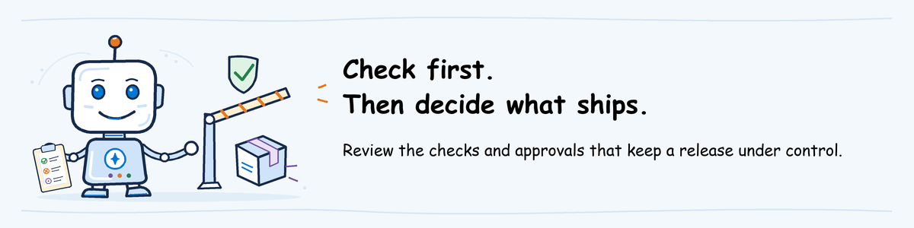

# Ship workshop lab



[Lab sequence](../README.md) | **Module 2 of 3**

## Lab definition

**Objective:** build a controlled release pipeline for the help desk agent.
Deploy a candidate, evaluate its exact version, require approval, release from
the reviewed commit, invoke the exact released version, and retain a release
manifest.

**Time:** allow 75 to 90 minutes elapsed. You perform about 60 minutes of work.
Each cloud deployment and evaluation can take 10 to 20 minutes, so use the wait
time to inspect the run.
Action 7 is a conditional recovery procedure and is not included in this
standard-path estimate unless a release fails.

**What you keep:** one rejected run, one released run, the evaluation evidence,
the approval record, the exact-version smoke-test log, and
`release-manifest.json`.

**Prerequisite:** complete [participant pre-work](../../pre-work/README.md#ship).
Keep the invitation's class repository URL and pipeline tool available. Your
alias is the part of your sign-in account before `@`.

Choose the pipeline tool named in your invitation:

- [GitHub Actions](github-actions/README.md)
- [Azure Pipelines](azure-pipelines/README.md)

**On this page**

1. [Understand the release identity contract](#1-understand-the-release-identity-contract)
2. [Clone the class repository](#2-clone-the-class-repository)
3. [Build the four-stage pipeline](#3-build-the-four-stage-pipeline)
4. [Run and reject the candidate](#4-run-and-reject-the-candidate)
5. [Fix and approve the release](#5-fix-and-approve-the-release)
6. [Retain the release evidence](#6-retain-the-release-evidence)
7. [Recover from a bad release](#7-recover-from-a-bad-release)

## 1. Understand the release identity contract

### Action 1: Identify what the pipeline can prove

- **Purpose:** Distinguish source equivalence from promotion of one immutable runtime version.
- **Navigation:** Read the five contract statements below before editing a file.
- **Result:** You can explain why the candidate and release have different agent names and version numbers.
- **If it fails:** Ask the instructor to compare the two identities in `azure.yaml`. Do not describe them as the same version.
- **Save:** Keep the contract with your release evidence.
- **Time:** 4 minutes.

Read this contract before you edit the pipeline:

- `helpdesk-ALIAS-test` and `helpdesk-ALIAS` are different agent identities.
- A version number is scoped to one identity. Test version `7` and release
  version `7` are not the same deployed object.
- The current documented `azd ai agent` commands deploy a new version and can
  invoke a selected version. They do not provide a documented command that
  promotes one immutable version from the test identity to the release identity.
- This lab therefore rebuilds the release identity from the same Git commit and
  configuration that passed evaluation. It does not claim that Foundry reused
  the candidate's immutable runtime artifact.
- `release-manifest.json` records both identities and versions, the Git commit,
  a source-and-configuration SHA-256 fingerprint, the pipeline URL, and the
  pinned extension version.

The pipeline sign-in identity performs deployments. The hosted agent has a
separate runtime identity. Give deployment roles to the pipeline identity.
Give access to downstream Azure services to the runtime identity only when the
agent needs that access.

**Expected result:** you can explain why the manifest contains two agent names
and two version numbers.

## 2. Clone the class repository

### Action 2: Create your isolated Ship branch

- **Purpose:** Work without changing another participant's pipeline or agents.
- **Navigation:** Open `agentops\workshop\labs\02-ship` in File Explorer, type `powershell` in the address bar, and run the block below.
- **Result:** Your clone is on `ship/<alias>`, and `azure.yaml` names your test and release agents.
- **If it fails:** Read the first Git error. Ask the instructor to check repository access before you retry.
- **Save:** Keep `$HOME\agentops-ship` and the branch name.
- **Time:** 6 minutes.

1. Open `agentops\workshop\labs\02-ship` in File Explorer.
2. Type `powershell` in the address bar and press Enter.
3. Run the block.

**What this block does:** clones the class repository, creates your branch, and
replaces `ALIAS` in the two configuration files. It changes local files only.

```powershell
$ErrorActionPreference = 'Stop'
$env:Path = (Resolve-Path '..\01-evaluate\.venv\Scripts').Path + ';' + $env:Path
$ClassRepo = (Read-Host 'Class repository URL').Trim()
$Alias = ((Read-Host 'Your alias').Trim().ToLower() -replace '[^a-z0-9]+', '-').Trim('-')
if (-not $Alias) { throw 'Enter the part of your sign-in account before @.' }
$Clone = Join-Path $HOME 'agentops-ship'
if (-not (Test-Path $Clone)) { git clone $ClassRepo $Clone }
if ($LASTEXITCODE -ne 0) { throw 'Clone failed. Read the error, then ask the instructor to check your repository access.' }
Set-Location $Clone
$Branch = "ship/$Alias"
if ((git branch --list $Branch) -or (git branch -r --list "origin/$Branch")) { git switch $Branch }
else { git switch -c $Branch }
if ($LASTEXITCODE -ne 0) { throw 'Branch creation failed. Read the Git error before you retry.' }
'azure.yaml','agentops.yaml' | ForEach-Object {
  (Get-Content $_) -replace 'ALIAS', $Alias | Set-Content $_
}
Select-String -Path azure.yaml -Pattern 'name: helpdesk'
```

Keep the window open.

**Expected result:** the output names `helpdesk-<your alias>-test` and
`helpdesk-<your alias>`.

## 3. Build the four-stage pipeline

### Action 3: Create and inspect the release pipeline

- **Purpose:** Make every release control visible before the first cloud run.
- **Navigation:** Run the generator for the pipeline tool in your invitation, then follow that tool's linked instructions page.
- **Result:** The file contains the four named stages, the pinned extension, the exact-version smoke test and the release manifest.
- **If it fails:** Stop if any stage or retained artifact is missing. Compare the file with the complete example on the pipeline-tool page.
- **Save:** Keep the generated pipeline file on your branch.
- **Time:** 15 minutes.

1. Generate the starting file for your selected pipeline tool.

**What this block does:** writes a generic pipeline file in your clone. It does
not deploy to Azure.

```powershell
# GitHub Actions
agentops workflow generate --kinds dev --deploy-mode azd
```

**What this block does:** writes the Azure Pipelines variant of the same generic
pipeline. It does not deploy to Azure.

```powershell
# Azure Pipelines
agentops workflow generate --kinds dev --deploy-mode azd --platform azure-devops
```

2. Open the instructions for [GitHub Actions](github-actions/README.md) or
   [Azure Pipelines](azure-pipelines/README.md).
3. Replace the generated file as instructed.
4. Find these four stages in the finished file:

   1. **Deploy candidate**
   2. **Evaluate candidate**
   3. **Approve and release**
   4. **Verify and record release**

5. Find the exact extension pin `1.0.0-beta.23`.
6. Find the call to `smoke-test.sh` and point to the released version argument.
7. Find the call to `write-release-manifest.sh`.

**Expected result:** both pipeline-tool variants implement the same four stages
and produce the same two retained artifacts.

## 4. Run and reject the candidate

### Action 4: Prove that the first candidate must not ship

- **Purpose:** Use evaluation and trace evidence to stop a known VPN regression.
- **Navigation:** Push the branch, open the current pipeline run, and follow steps 2 through 11 below.
- **Result:** The evaluation identifies `Software Support`, you reject the approval, and no release is created.
- **If it fails:** Stop at the first failed task. Do not approve a run that lacks its report, exact candidate version or trace.
- **Save:** Download `agentops-dev-results` and retain the rejected run URL.
- **Time:** 15 minutes active, plus 10 to 20 minutes cloud wait.

1. Commit and push your pipeline.

**What this block does:** saves your pipeline on your branch. A GitHub push
starts the workflow. Azure Pipelines starts after you create it from its
instructions page.

```powershell
git add -A
git commit -m "Add Ship pipeline for $Alias"
git push -u origin "ship/$Alias"
```

2. Open the run.
3. Open **1. Deploy candidate** and record the candidate identity and version.
4. Open **2. Evaluate candidate**.
5. Download `agentops-dev-results`.
6. Open `report.md`.
7. Open `cloud_evaluation.json`, copy `report_url`, and open that URL.
8. Open the `vpn-ticket` trace.
9. Select `execute_tool create_ticket`.
10. Read the returned `queue`.
11. Reject **3. Approve and release** with the reason `VPN ticket routed to
    Software Support`.

If the evaluation stage fails before it publishes evidence, stop. Open the first
failed task, fix that error, and push again. Do not approve a run that lacks the
report and trace.

**Expected result:** the run ends without a release. Stage 4 does not run.

## 5. Fix and approve the release

### Action 5: Release the corrected source revision

- **Purpose:** Show that approval follows fresh evidence for the corrected commit.
- **Navigation:** Run the source-change block, open the new pipeline run, and follow steps 2 through 10 below.
- **Result:** Evaluation shows `Network Support`, approval succeeds, and the exact released version passes the tool smoke test.
- **If it fails:** Reject or leave the approval pending. Fix the failed control and start a complete new run.
- **Save:** Keep the released run URL, evaluation artifact and smoke-test log.
- **Time:** 15 minutes active, plus 10 to 20 minutes cloud wait.

1. Change both service definitions to the baseline behavior.

**What this block does:** changes the reviewed source configuration, commits it,
and starts a new run.

```powershell
(Get-Content azure.yaml) -replace 'HELPDESK_VARIANT: candidate', 'HELPDESK_VARIANT: baseline' | Set-Content azure.yaml
git commit -am "Release the fixed VPN routing"
git push
```

2. Open the new run.
3. Read the new evaluation report.
4. Open the `vpn-ticket` trace.
5. Read `queue: Network Support`.
6. Approve **3. Approve and release**.
7. Open **4. Verify and record release**.
8. Read `Testing exact target`.
9. Read the released identity and version.
10. Read `SIM-VPN-001`, `Network Support`, and `Smoke test passed`.

The release stage performs a second deployment under the release identity. The
candidate and release share the reviewed commit and fingerprint, but they have
independently assigned Foundry versions.

**Expected result:** all four stages pass.

## 6. Retain the release evidence

### Action 6: Validate the release manifest

- **Purpose:** Make the evaluated and released identities, source and approval auditable.
- **Navigation:** Download `ship-release-manifest`, open `release-manifest.json`, and perform checks 3 through 6 below.
- **Result:** The manifest matches both pipeline versions, the branch commit and the exact-version smoke test.
- **If it fails:** Mark the release evidence incomplete. Keep the run and ask the instructor before using it in Observe and Operate.
- **Save:** Keep the manifest with both run URLs.
- **Time:** 6 minutes.

1. Download `ship-release-manifest`.
2. Open `release-manifest.json`.
3. Match `evaluated.version` to stage 1.
4. Match `released.version` to stage 3 and the smoke-test log.
5. Match `provenance.git_commit` to this command.

**What this block does:** prints the commit represented by your branch. Local only.

```powershell
git rev-parse HEAD
```

6. Keep links to the rejected and released runs with the manifest.

**Expected result:** another person can identify what was evaluated, what was
released, which commit produced both deployments, who approved the release, and
which exact released version passed the tool smoke test.

## 7. Recover from a bad release

### Action 7: Restore through the full release chain

- **Purpose:** Recover without bypassing evaluation, approval or exact-version verification.
- **Navigation:** Restrict the affected endpoint when authorized, retain the failed evidence, run the revert block, then repeat all four stages.
- **Result:** A new commit passes evaluation, approval, smoke testing and manifest generation before endpoint access is restored.
- **If it fails:** Keep access restricted and escalate to the instructor or environment owner. Do not rerun only the release stage.
- **Save:** Keep the failed and recovered manifests, runs and commits.
- **Time:** 10 minutes active, plus one complete pipeline run.

Use this procedure if stage 4 fails or a later observation finds a release
problem:

1. Stop new approvals for the affected branch.
2. Restrict or disable the released endpoint if the instructor's class access
   permits it. Otherwise ask the instructor to do so.
3. Keep the failed run, logs, evaluation artifact, and manifest.
4. Revert the bad commit.

**What this block does:** creates a new commit that reverses the last change.
Review the resulting diff before you push.

```powershell
git revert HEAD
git show --stat
git push
```

5. Run all four stages.
6. Review the new evaluation evidence.
7. Approve only after the gate passes.
8. Download the new release manifest.
9. Restore endpoint access after stage 4 passes.

Do not rerun only the release stage. A release-only rerun breaks the current
evaluation, approval, exact-version smoke test, and manifest chain.

The released agent and its retained evidence are the starting point for
[Observe and Operate](../03-observe-operate/lab.md).
