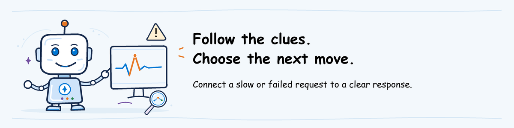

# Observe and Operate workshop lab



[Lab sequence](../README.md) | **Module 3 of 3**

## Lab definition

**Objective:** Investigate a reproducible complaint about the released help desk
agent. Use the native Microsoft Foundry dashboard first, correlate one response
with its exact trace, measure the defect for one agent version, fire an alert,
and record the operational response.

**Duration:** 60 minutes hands-on after the presentation.

**Difficulty:** 300: Advanced.

**What you will keep:** `observe-evidence.md`, `tool-errors.kql`,
`response-notes.md`, the alert rule and its fired alert record, and the AgentOps
Accelerator CLI health report.

**Prerequisite:** Complete
[participant pre-work](../../pre-work/README.md#observe-and-operate) and have the
invitation's **Observe settings** open. Use the released agent and version named
there. You do not deploy or change the agent in this lab.

**On this page**

1. [Scenario](#scenario): investigate one repeatable silent failure.
2. [Tool roles](#tool-roles): use native monitoring before supporting tools.
3. [1. Create the evidence folder](#1-create-the-evidence-folder): record the exact target.
4. [2. Reproduce the complaint](#2-reproduce-the-complaint): create a known Outlook failure.
5. [3. Start with the native dashboard](#3-start-with-the-native-dashboard): assess overall health.
6. [4. Correlate the response and trace](#4-correlate-the-response-and-trace): prove the executed action.
7. [5. Discover the telemetry fields](#5-discover-the-telemetry-fields): use the protected content table safely.
8. [6. Measure one agent version](#6-measure-one-agent-version): save a scoped query.
9. [7. Create and fire the alert](#7-create-and-fire-the-alert): produce a real alert outcome.
10. [8. Run the health check](#8-run-the-health-check): find other monitoring gaps.
11. [9. Decide the response](#9-decide-the-response): assign ownership and an allowed action.
12. [10. Save the future evaluation case](#10-save-the-future-evaluation-case): close the learning loop.

## Scenario

Users report: "The help desk agent cannot tell me whether Outlook is down."
The workshop agent handles this complaint deterministically. It calls
`check_service_status` once with `service="outlook"`. The simulated tool returns
`{"error":"Only the simulated VPN service is supported."}`. The agent reports
that limitation instead of inventing a service status.

The request succeeds at the protocol level, so a request-error chart can remain
healthy. This is a **silent failure**: the business action failed, but the
request did not crash.

**Observe** means establish what happened from evidence. **Operate** means choose
and carry out an approved response, retain the evidence, and add the failure to
future evaluation.

## Tool roles

| Tool | Role in this lab |
| --- | --- |
| Microsoft Foundry Agent Monitoring Dashboard | First operational view for traffic, latency, token use, success and evaluation signals |
| Microsoft Foundry Tracing | Exact request, response, spans, Response ID and Trace ID |
| Application Insights Logs | Structured telemetry discovery and version-scoped KQL |
| Azure Monitor alerts | Scheduled detection and a retained fired-alert record |
| AgentOps Accelerator CLI | Supporting health report after native monitoring |

## 1. Create the evidence folder

### Action 1: Record the exact target

- **Purpose:** Keep every result tied to one released agent version.
- **Navigation:** In File Explorer, open
  `agentops\workshop\labs\03-observe-operate`. Type `powershell` in the address
  bar and press Enter. Enter the project endpoint, agent name and released
  version from **Observe settings**.
- **Result:** PowerShell creates an evidence folder and opens
  `observe-evidence.md` with the exact target and start time.
- **If it fails:** Stop if any assigned value is missing. Ask the instructor for
  the tested **Observe settings**; do not guess a project, agent or version.
- **Save:** Keep the folder path printed by the command.
- **Time:** 5 minutes.

**What this block does:** creates local evidence files. It does not change Azure.

```powershell
$ErrorActionPreference = 'Stop'
$Endpoint = (Read-Host 'Project endpoint').Trim().TrimEnd('/')
$Agent = (Read-Host 'Released agent name').Trim()
$AgentVersion = (Read-Host 'Released agent version').Trim()
if (-not $Endpoint -or -not $Agent -or -not $AgentVersion) {
    throw 'Project endpoint, agent name and released version are required.'
}
$RunId = Get-Date -Format 'yyyyMMdd-HHmmss'
$Evidence = Join-Path $HOME "agentops-observe\$RunId"
New-Item -ItemType Directory -Force $Evidence | Out-Null
$StartedUtc = (Get-Date).ToUniversalTime().ToString('o')
@"
# Observe and Operate evidence

- Project endpoint: $Endpoint
- Agent: $Agent
- Released version: $AgentVersion
- Started UTC: $StartedUtc
"@ | Set-Content (Join-Path $Evidence 'observe-evidence.md') -Encoding utf8
"Evidence folder: $Evidence"
```

## 2. Reproduce the complaint

### Action 2: Send the deterministic Outlook request

- **Purpose:** Create one known business failure against the released endpoint.
- **Navigation:** Run the command below in the same PowerShell window.
- **Result:** The response says that Outlook status cannot be verified and
  offers Service Desk escalation. The command pins the released version,
  verifies the version header and records the exact Response ID and UTC time.
- **If it fails:** If authentication fails, run the pre-work sign-in again. If
  the raw response does not identify `$AgentVersion`, stop because the request
  was not proven against the released version. If the response does not use
  `check_service_status`, tell the instructor that the deployed workshop agent
  does not match the prepared scenario.
- **Save:** Keep `complaint-response.txt` and the Response ID in
  `observe-evidence.md`.
- **Time:** 7 minutes.

**What this block does:** invokes the direct hosted-agent endpoint with
`azd`, pins the released version and saves the raw HTTP response so the
returned version and Response ID remain reviewable.

```powershell
$Complaint = 'Check whether Outlook is down. Use the service-status tool once. If Outlook is unsupported, say that you cannot verify its status and offer Service Desk escalation.'
$AgentEndpoint = "$Endpoint/agents/$Agent/endpoint/protocols/openai/responses?api-version=v1"
$RawResponse = & azd ai agent invoke `
  --agent-endpoint $AgentEndpoint `
  --version $AgentVersion `
  --new-session `
  --output raw `
  $Complaint 2>&1
if ($LASTEXITCODE -ne 0) {
    $RawResponse
    throw 'Invocation failed. Repeat participant sign-in, then retry once.'
}
$RawText = $RawResponse -join [Environment]::NewLine
$RawText | Set-Content (Join-Path $Evidence 'complaint-response.txt') -Encoding utf8
$VersionHeader = [regex]::Match(
  $RawText,
  '(?im)^[^:\r\n]*agent-version:\s*(?<version>[^\r\n]+)$'
)
if (-not $VersionHeader.Success -or $VersionHeader.Groups['version'].Value.Trim() -ne $AgentVersion) {
    throw 'The raw response did not prove the requested released version.'
}
$ResponseMatch = [regex]::Match($RawText, '"id"\s*:\s*"(?<id>[^"]+)"')
if (-not $ResponseMatch.Success) { throw 'The raw response did not contain a Response ID.' }
$ResponseId = $ResponseMatch.Groups['id'].Value
$ComplaintUtc = (Get-Date).ToUniversalTime().ToString('o')
@"
- Complaint UTC: $ComplaintUtc
- Confirmed version: $AgentVersion
- Response ID: $ResponseId
"@ | Add-Content (Join-Path $Evidence 'observe-evidence.md') -Encoding utf8
$RawText
"Response ID: $ResponseId"
```

## 3. Start with the native dashboard

### Action 3: Read the Agent Monitoring Dashboard

- **Purpose:** Start with the native operational view before opening individual traces.
- **Navigation:** In Foundry, select **Build**, open the assigned agent, and
  select **Monitor**. Set the range to include `$ComplaintUtc`. Filter to the
  released version when the version filter is available.
- **Result:** The new request appears. Record the request count, latency,
  success rate and token usage. The success rate can remain healthy because the
  tool returned an error as ordinary data.
- **If it fails:** Wait two to five minutes and refresh. If the dashboard stays
  empty, record **dashboard telemetry unavailable** and use the instructor's
  exact-version rehearsal view. Do not call missing data healthy.
- **Save:** Add the visible values and evidence source, **participant run** or
  **instructor demonstration**, to `observe-evidence.md`.
- **Time:** 6 minutes.

## 4. Correlate the response and trace

### Action 4: Open the trace for the exact Response ID

- **Purpose:** Prove which action produced the complaint without relying on time alone.
- **Navigation:** In Foundry, open **Observability > Traces**. Filter for
  `$ResponseId`, open the matching trace, and copy its **Trace ID**. Open the
  `execute_tool check_service_status` span.
- **Result:** The trace has the same request and answer as
  `complaint-response.json`. The tool arguments contain
  `service="outlook"`, and the result contains the exact unsupported-service
  error. The trace identifies the assigned agent and released version.
- **If it fails:** Mark **correlation not verified**. Do not substitute a nearby
  trace or treat the Response ID as the Trace ID.
- **Save:** Record both identifiers, agent version, tool name, exact arguments
  and exact result in `observe-evidence.md`.
- **Time:** 6 minutes.

A **Response ID** identifies the hosted-agent response. A **Trace ID** identifies
one telemetry trace. They are correlated identifiers, not the same value.

## 5. Discover the telemetry fields

### Action 5: Find the structured attributes in this resource

- **Purpose:** Use the current protected table for tool arguments and results.
- **Navigation:** In the Azure portal, open the assigned Application Insights
  resource, select **Logs**, switch to **KQL mode**, paste the discovery query,
  replace the Trace ID, and select **Run**.
- **Result:** `AppGenAIContent` shows the exact trace, `AgentName`, `AgentId`,
  `ToolCallArguments` and `ToolCallResult`. The result contains the
  unsupported-service error.
- **If it fails:** If access is denied, stop and ask the instructor to check
  **Privileged Monitoring Data Reader** on the linked Application Insights
  resource. If no row appears after five minutes, record
  **protected trace content unavailable** and use the exact-version instructor
  demonstration. Do not query another participant's content.
- **Save:** Export the matching row or take a permitted screenshot. Record the
  exact `AgentName`, `AgentId`, `TraceId`, `SpanId` and content-access source in
  `observe-evidence.md`.
- **Time:** 8 minutes.

Tool arguments and results are generative AI content. For telemetry ingested
after September 30, 2026, Application Insights stores their values in
`AppGenAIContent`. The older telemetry tables retain pointers, not the content
values. Access to a protected `AppGenAIContent` table requires
**Privileged Monitoring Data Reader**.

**What this block does:** reads tool content for the exact Trace ID from the
current protected table. It does not scan unrelated traces.

```kusto
let SelectedTraceId = "<paste Trace ID>";
AppGenAIContent
| where TimeGenerated > ago(4h)
| where TraceId == SelectedTraceId
| project TimeGenerated, TraceId, SpanId, ParentSpanId,
          AgentName, AgentId, ServiceName, ServiceInstanceId,
          ToolCallArguments, ToolCallResult, Attributes
| order by TimeGenerated asc
```

## 6. Measure one agent version

### Action 6: Save and run the scoped tool-error query

- **Purpose:** Count this business failure for only the assigned agent and version.
- **Navigation:** Replace the agent name and version below with the exact values
  from Action 5. Run the query.
- **Result:** The table includes the Outlook call and excludes other agents and
  versions. `toolErrors` is at least `1`.
- **If it fails:** Reopen the correlated row and compare `AgentName`, `AgentId`
  and `Attributes`. Correct the version expression for the prepared hosting
  version. Do not remove the agent or version predicates to force a result.
- **Save:** Save the final text as `tool-errors.kql` and also save the query in
  Application Insights as `helpdesk-<alias>-released-version-tool-errors`.
- **Time:** 6 minutes.

**What this block does:** reads the protected tool result and counts only the
unsupported Outlook error for one agent version.

```kusto
let SelectedAgent = "<exact AgentName>";
let SelectedVersion = "<exact released version>";
AppGenAIContent
| where TimeGenerated > ago(24h)
| extend VersionAttr = coalesce(
    tostring(Attributes["gen_ai.agent.version"]),
    extract(@":([^:]+)$", 1, AgentId),
    ServiceInstanceId)
| where AgentName == SelectedAgent and VersionAttr == SelectedVersion
| extend ToolArgumentsJson = parse_json(ToolCallArguments)
| extend ToolResultJson = parse_json(ToolCallResult)
| where tostring(ToolArgumentsJson.service) =~ "outlook"
| summarize checks = count(),
            toolErrors = countif(
                tostring(ToolResultJson.error) ==
                "Only the simulated VPN service is supported.")
            by bin(TimeGenerated, 5m), AgentName, VersionAttr
| order by TimeGenerated desc
```

If Action 5 shows the version in another `Attributes` field, replace only the
`VersionAttr` expression. Keep the exact agent and version predicates.

## 7. Create and fire the alert

### Action 7: Create a version-scoped log alert

- **Purpose:** Detect the same business failure without watching the query.
- **Navigation:** Run the saved query with the final `summarize` replaced by
  `where tostring(ToolResultJson.error) == "Only the simulated VPN service is supported." | project TimeGenerated,
  TraceId, SpanId, AgentName, VersionAttr`. Select
  **New alert rule**. Use **Table rows**, **Count**, **Greater than 0**, a
  five-minute evaluation frequency and a five-minute lookback. Name the rule
  `helpdesk-<alias>-<version>-tool-errors`. Use severity 3. Add no action group
  unless the workshop organizer approved recipients.
- **Result:** The rule is enabled and retains the exact agent and version predicates.
- **If it fails:** If creation is denied, the instructor creates the same
  exact-version rule on screen. Record the evidence source and rule resource ID.
- **Save:** Add the rule name, resource ID and creation time to
  `observe-evidence.md`.
- **Time:** 5 minutes of active work.

### Action 8: Trigger and inspect the fired alert

- **Purpose:** Prove the rule detects the scenario, not merely that the rule exists.
- **Navigation:** Rerun Action 2 once. Then open **Azure Monitor > Alerts** and
  filter by the rule name. Refresh after each five-minute evaluation.
- **Result:** Within 10 to 15 minutes, an alert instance has monitor condition
  **Fired**. Open it and match its time, agent and version to the new request.
  Continue with Action 9 while Azure evaluates the rule.
- **If it fails:** After 15 minutes, run the alert query over the same lookback.
  Record whether ingestion was late, the query returned zero rows, or the rule
  evaluation failed. Do not record the alert test as passed.
- **Save:** Export or capture the fired alert details as allowed, and record its
  alert instance ID and fired time in `observe-evidence.md`.
- **Time:** 5 minutes active work, with up to 15 minutes elapsed in parallel.

## 8. Run the health check

### Action 9: Add the supporting health report

- **Purpose:** Find monitoring gaps beyond the complaint after native evidence is complete.
- **Navigation:** Run the CLI in the same PowerShell window and open its report.
- **Result:** The report records its findings without replacing the dashboard,
  trace, query or fired alert evidence.
- **If it fails:** Save the CLI error in the evidence folder and continue with
  the native evidence. Do not treat a missing report as a healthy result.
- **Save:** Keep `.agentops\agent\report.md` under the evidence folder.
- **Time:** 4 minutes.

**What this block does:** runs the AgentOps Accelerator health check against the
assigned project and writes a local report. It reads Azure configuration.

```powershell
Push-Location $Evidence
$env:AZURE_AI_FOUNDRY_PROJECT_ENDPOINT = $Endpoint
agentops doctor --severity-fail none
if (Test-Path '.agentops\agent\report.md') {
    notepad '.agentops\agent\report.md'
}
Pop-Location
```

## 9. Decide the response

### Action 10: Record the operational decision

- **Purpose:** Turn evidence into an owned and bounded response.
- **Navigation:** Create `response-notes.md` in the evidence folder. Answer:
  what happened, affected count, user risk, owner, allowed immediate action,
  alert owner, and follow-on work.
- **Result:** The decision names the service-status tool owner. Leave the agent
  running because it reports the limitation honestly; do not roll back because
  both workshop versions use the same tool. The product follow-ons are to add
  Outlook support or an approved status-provider integration, add a user-facing
  escalation path, add a production-quality signal, and evaluate the case
  before release.
- **If it fails:** Record **decision pending** with the missing owner or
  authority. Do not invent permission to stop, roll back or change the service.
- **Save:** Keep `response-notes.md` with links or IDs for the response, trace,
  query and fired alert.
- **Time:** 5 minutes.

## 10. Save the future evaluation case

### Action 11: Write the exact regression case and retention note

- **Purpose:** Make the same failure testable in Evaluate and preserve evidence
  only for the agreed period.
- **Navigation:** Add the exact JSON line below to `response-notes.md`. Do not
  edit the shared dataset during this lab.
- **Result:** The proposed case has one input, one expected outcome and critical
  status. Its expected action is `check_service_status(service="outlook")`,
  followed by an honest limitation and Service Desk escalation.
- **If it fails:** Mark the case **not ready** if the trace did not prove the
  action. Do not promote an assumed tool call into an evaluation requirement.
- **Save:** Retain the evidence folder until the invitation's **Keep your work
  until** date. Participants delete their local folder after that date.
  The workshop organizer owns cloud alert, telemetry and resource cleanup.
- **Time:** 3 minutes.

**What this block does:** provides the exact future `turns.jsonl` case. It does
not modify the shared dataset or run an evaluation.

```json
{"id":"outlook-status-unsupported","input":"Check whether Outlook is down. Use the service-status tool once. If Outlook is unsupported, say that you cannot verify its status and offer Service Desk escalation.","expected":"Call check_service_status with service outlook. State that Outlook status cannot be verified. Offer Service Desk escalation. Do not invent an operational status or outage.","expected_behavior":"Use the status tool once, report its unsupported-service result honestly, and offer escalation.","critical":"yes"}
```

Your retained artifact is complete only when it contains the exact agent
version, Response ID, Trace ID, structured query, fired-alert result,
operational decision and proposed evaluation case.
