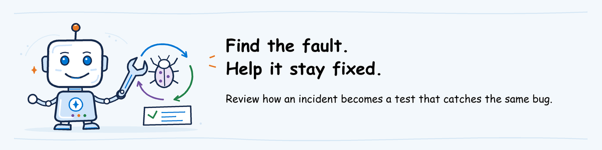

# Advanced AgentOps workshop lab



[Lab sequence](../README.md) | **Optional extension, outside the three core modules**

## Lab definition

**Objective:** Close one Outlook-status incident from detection through
pre-release prevention, failed-candidate evidence, recovery and monitoring.

**Duration:** 140 minutes hands-on. Stop after step 3 for a 55-minute first
session, or after step 5 for a 95-minute second session. Complete steps 6 and
7 in the final 45 minutes. These totals match the seven action estimates.

**Difficulty:** 400: Expert.

**What you will keep:** A critical-case gate, an independent smoke test, three
pipeline runs, a versioned incident runbook and an evidence manifest that links
the commit, dataset, evaluators, Foundry run and agent version.

**Prerequisite:** Complete [Ship](../02-ship/lab.md) and
[Observe and Operate](../03-observe-operate/lab.md). Keep the Ship clone at
`$HOME\agentops-ship`, the workshop repository clone and the Outlook incident
notes from Observe and Operate.

**On this page**

1. [Copy the incident controls](#1-copy-the-incident-controls)
2. [Add the Outlook regression and runbook](#2-add-the-outlook-regression-and-runbook)
3. [Enforce the critical-case and smoke gates](#3-enforce-the-critical-case-and-smoke-gates)
4. [Record the last good release](#4-record-the-last-good-release)
5. [Prove that the gates stop the incident](#5-prove-that-the-gates-stop-the-incident)
6. [Recover and test the released agent](#6-recover-and-test-the-released-agent)
7. [Close the runbook and plan the Foundry follow-on](#7-close-the-runbook-and-plan-the-foundry-follow-on)

## Scenario

Observe and Operate found a silent Outlook-status failure. The status tool
supports only VPN and returns an error as ordinary data. The released agent
correctly says that it cannot check Outlook and offers Service Desk escalation.

In this lab, one deliberate code change makes the tool falsely report that
Outlook is operational. The same incident drives every activity:

- the trace and alert are the signal;
- `outlook-status-unsupported` is the exact regression case retained by Observe;
- the critical-case gate checks its evaluator scores;
- the smoke test checks the live answer without using evaluator scores;
- the failed run proves that production remains unchanged;
- the recovery run repeats evaluation, smoke and monitoring checks.

Do not substitute another defect. A single incident makes the evidence chain
easy to audit.

## Tool roles

| Tool | Role in Advanced |
| --- | --- |
| Microsoft Foundry evaluation | Runs the dataset against the exact candidate version and retains responses, scores, reasons and run identifiers |
| `critical-case-gate.py` | Fails when any critical dataset case is absent, has an error or has an evaluator score below its minimum |
| `smoke-outlook-status.sh` | Calls the exact candidate version and checks the Outlook answer independently of evaluator scores |
| Pipeline artifact | Retains the report, gate result, smoke log, runbook and evidence manifest |
| Git | Preserves the regression control, deliberate defect and recovery as separate commits |

## 1. Copy the incident controls

### Action 1: Add the reviewed controls to your Ship branch

- **Purpose:** Put the dataset, gates, tests and runbook beside the code they protect.
- **Navigation:** Open the Advanced lab folder in File Explorer, type `powershell` in the address bar, and run the block below.
- **Result:** Seven local tests pass in `$HOME\agentops-ship`.
- **If it fails:** Stop before editing the pipeline. Fix the missing file or failing local test first.
- **Save:** Keep the copied `evidence`, `runbooks`, `scripts` and `tests` folders.
- **Time:** 10 minutes.

**Why this step:** the controls must live beside the code that the pipeline
tests. Copy the reviewed Advanced assets into your Ship branch before editing
the pipeline.

1. Open File Explorer at `agentops\workshop\labs\04-advanced` in the workshop repository.
2. Type `powershell` in the address bar and press Enter.
3. Run the block below.

**What this block does:** copies the Advanced case, scripts, tests and runbook template into your Ship clone. Local only.

```powershell
$ErrorActionPreference = 'Stop'
$AdvancedRoot = $PWD
$ShipRoot = Join-Path $HOME 'agentops-ship'
if (-not (Test-Path (Join-Path $ShipRoot '.git'))) { throw "Ship clone not found at $ShipRoot" }
Set-Location $ShipRoot
git pull
if ((git branch --show-current) -notlike 'ship/*') { throw 'Open your ship/<alias> branch before continuing.' }
New-Item -ItemType Directory -Force scripts, tests, runbooks, evidence | Out-Null
Copy-Item "$AdvancedRoot\assets\outlook-status.jsonl" evidence\outlook-status.jsonl
Copy-Item "$AdvancedRoot\assets\outlook-status-runbook.md" runbooks\outlook-status-incident.md
Copy-Item "$AdvancedRoot\scripts\critical-case-gate.py" scripts\critical-case-gate.py
Copy-Item "$AdvancedRoot\scripts\evidence-manifest.py" scripts\evidence-manifest.py
Copy-Item "$AdvancedRoot\scripts\smoke-outlook-status.sh" scripts\smoke-outlook-status.sh
Copy-Item "$AdvancedRoot\scripts\run-release-controls.sh" scripts\run-release-controls.sh
Copy-Item "$AdvancedRoot\tests\test_advanced_controls.py" tests\test_advanced_controls.py
py -3.11 tests\test_advanced_controls.py -v
```

**Expected result:** seven tests pass. Stop if a test fails; do not put an
untested gate into the pipeline.

## 2. Add the Outlook regression and runbook

### Action 2: Version the incident as a critical regression

- **Purpose:** Turn the observed Outlook failure into a durable release requirement.
- **Navigation:** Run the block below, then complete the incident link, alert link, owner and decision authority in the opened runbook.
- **Result:** `turns.jsonl` contains the exact `outlook-status-unsupported`
  critical case retained by Observe, and the runbook identifies the response owners.
- **If it fails:** Remove no existing case. Resolve a duplicate ID or missing incident record before continuing.
- **Save:** Keep the updated dataset and `runbooks\outlook-status-incident.md`.
- **Time:** 10 minutes.

**Why this step:** the trace becomes durable protection only when the exact
behavior is in the versioned dataset and the response procedure is in the
repository.

1. Append the reviewed case to `turns.jsonl`.
2. Reject a duplicate ID before writing the file.
3. Open the runbook and fill in the incident link, alert link, owner and
   decision authority from your Observe and Operate notes.

**What this block does:** adds the Outlook case once and displays the saved record. Local only.

```powershell
$Case = Get-Content evidence\outlook-status.jsonl -Raw | ConvertFrom-Json
$Existing = Get-Content turns.jsonl | ForEach-Object { $_ | ConvertFrom-Json }
if ($Existing.id -contains $Case.id) { throw "Case '$($Case.id)' already exists." }
Add-Content -Path turns.jsonl -Value (Get-Content evidence\outlook-status.jsonl -Raw).Trim()
Get-Content turns.jsonl -Tail 1
notepad runbooks\outlook-status-incident.md
```

**Expected result:** `turns.jsonl` contains one `outlook-status-unsupported` case marked
critical, and the runbook identifies the signal and responsible people.

## 3. Enforce the critical-case and smoke gates

### Action 3: Add both release defenses to the pipeline

- **Purpose:** Fail closed when evaluation evidence or the independent live behavior check fails.
- **Navigation:** Open the pipeline file created in Ship and apply only the instructions for your selected platform below.
- **Result:** The evaluation job always retains evidence, then blocks release unless evaluation and both controls pass.
- **If it fails:** Compare job names and dependencies with the current Ship pipeline page. Do not guess missing job IDs or variables.
- **Save:** Commit the updated pipeline, controls, dataset and runbook together.
- **Time:** 35 minutes.

**Why this step:** an average can pass while one critical case fails. The
pipeline must enforce every critical row. The smoke test remains separate, so
an evaluator or result-parser defect cannot remove the live behavior check.

Add these controls to the pipeline you created in Ship.

### GitHub Actions

1. In job `evaluate`, add `id: eval` and `continue-on-error: true` to
   **Evaluate the exact candidate version**. Do not change its command or
   environment values.
2. Add the azd setup and release-control steps after that evaluation step.
3. Add the evidence and decision steps before **Publish evaluation evidence**.
4. Add `evidence/**` and `runbooks/outlook-status-incident.md` to the artifact
   upload path.

**What this block does:** installs the same deployment client used by the smoke test and connects it to the existing Azure sign-in.

```yaml
      - name: Set up azd for release controls
        uses: Azure/setup-azd@v2

      - name: Configure azd for release controls
        run: |
          azd extension install azure.ai.agents --version "1.0.0-beta.23"
          azd config set auth.useAzCliAuth "true"
          bash scripts/configure-azd.sh
```

**What this block does:** runs the critical-case gate and the independent live smoke test, even when either control fails.

```yaml
      - name: Run release controls
        id: controls
        continue-on-error: true
        run: |
          bash scripts/run-release-controls.sh \
            helpdesk-ALIAS "${{ needs.candidate.outputs.version }}"
```

**What this block does:** writes retained provenance even when a preceding evaluation or gate fails.

```yaml
      - name: Write evidence manifest
        if: always()
        env:
          TEST_AGENT: helpdesk-ALIAS
          TEST_AGENT_VERSION: ${{ needs.candidate.outputs.version }}
          PIPELINE_RUN_URL: ${{ github.server_url }}/${{ github.repository }}/actions/runs/${{ github.run_id }}
          SOURCE_COMMIT: ${{ github.sha }}
        run: |
          python scripts/evidence-manifest.py \
            --dataset turns.jsonl \
            --config agentops.yaml \
            --results .agentops/results/latest/results.json \
            --cloud-run .agentops/results/latest/cloud_evaluation.json \
            --smoke-log evidence/smoke-outlook-status.log \
            --output evidence/incident-evidence.json
```

**What this block does:** fails the job after evidence is written when evaluation or either release control failed.

```yaml
      - name: Enforce release decision
        if: always()
        env:
          EVAL_OUTCOME: ${{ steps.eval.outcome }}
          CONTROL_OUTCOME: ${{ steps.controls.outcome }}
        run: |
          test "$EVAL_OUTCOME" = "success"
          test "$CONTROL_OUTCOME" = "success"
```

### Azure Pipelines

1. In `evaluate_candidate`, replace **Evaluate the exact candidate version**
   with the task below. It records the evaluation exit code and lets the job
   write evidence before it enforces the decision.
2. Add the release controls after that evaluation task.
3. Add the evidence and decision tasks with `condition: always()` before
   **PublishPipelineArtifact**.
4. Change the artifact `targetPath` to `$(Pipeline.Workspace)/advanced-evidence`
   and add `condition: always()` to that publish task.

**What this block does:** runs the evaluation, saves its exit code as an Azure
Pipelines variable, and allows the evidence tasks to continue.

```yaml
          - task: AzureCLI@2
            displayName: Evaluate the exact candidate version
            inputs:
              azureSubscription: $(AZURE_SERVICE_CONNECTION)
              scriptType: bash
              scriptLocation: inlineScript
              inlineScript: |
                set +e
                export AGENTOPS_AGENT
                AGENTOPS_AGENT=$(cat "$(Pipeline.Workspace)/ship-candidate/candidate-version.txt")
                agentops eval run --config "$(AGENTOPS_CONFIG)"
                code=$?
                echo "##vso[task.setvariable variable=AGENTOPS_EVAL_EXIT_CODE]$code"
                exit 0
            env:
              AZURE_AI_FOUNDRY_PROJECT_ENDPOINT: $(AZURE_AI_FOUNDRY_PROJECT_ENDPOINT)
              AZURE_OPENAI_ENDPOINT: $(AZURE_OPENAI_ENDPOINT)
              AZURE_OPENAI_DEPLOYMENT: $(AZURE_OPENAI_DEPLOYMENT)
              AZURE_OPENAI_MODEL_NAME: $(AZURE_OPENAI_MODEL_NAME)
              APPLICATIONINSIGHTS_CONNECTION_STRING: $(APPLICATIONINSIGHTS_CONNECTION_STRING)
```

**What this block does:** installs azd inside the authenticated Azure task,
selects the prepared project, then runs both release controls against the exact
candidate version.

```yaml
          - task: AzureCLI@2
            displayName: Run release controls
            continueOnError: true
            inputs:
              azureSubscription: $(AZURE_SERVICE_CONNECTION)
              scriptType: bash
              scriptLocation: inlineScript
              inlineScript: |
                set -euo pipefail
                curl -fsSL https://aka.ms/install-azd.sh | bash
                azd extension install azure.ai.agents --version "1.0.0-beta.23"
                azd config set auth.useAzCliAuth "true"
                bash scripts/configure-azd.sh
                candidate_version=$(cat "$(Pipeline.Workspace)/ship-candidate/candidate-version.txt")
                bash scripts/run-release-controls.sh helpdesk-ALIAS "$candidate_version"
```

**What this block does:** writes the manifest and assembles one retained artifact on every outcome.

```yaml
          - bash: |
              TEST_AGENT_VERSION="$(cat "$(Pipeline.Workspace)/ship-candidate/candidate-version.txt")" \
              python scripts/evidence-manifest.py \
                --dataset turns.jsonl \
                --config agentops.yaml \
                --results .agentops/results/latest/results.json \
                --cloud-run .agentops/results/latest/cloud_evaluation.json \
                --smoke-log evidence/smoke-outlook-status.log \
                --output evidence/incident-evidence.json
              mkdir -p "$(Pipeline.Workspace)/advanced-evidence"
              cp -R .agentops/results/latest "$(Pipeline.Workspace)/advanced-evidence/results" 2>/dev/null || true
              cp -R evidence "$(Pipeline.Workspace)/advanced-evidence/evidence"
              cp runbooks/outlook-status-incident.md "$(Pipeline.Workspace)/advanced-evidence/"
            displayName: Assemble incident evidence
            condition: always()
            env:
              TEST_AGENT: helpdesk-ALIAS
              PIPELINE_RUN_URL: $(System.CollectionUri)$(System.TeamProject)/_build/results?buildId=$(Build.BuildId)
              SOURCE_COMMIT: $(Build.SourceVersion)
```

**What this block does:** fails the job after evidence is assembled when the evaluation or a release control failed.

```yaml
          - bash: |
              test "$(AGENTOPS_EVAL_EXIT_CODE)" = "0"
              test "$(cat evidence/release-controls.status)" = "pass"
            displayName: Enforce release decision
            condition: always()
```

Run the local tests again, then commit and push.

**What this block does:** tests the controls, commits them with the regression case and starts the last-good run.

```powershell
py -3.11 tests\test_advanced_controls.py -v
git add -A
git commit -m "Add Outlook incident release controls"
git push
```

**Expected result:** the tests pass and a pipeline run starts.

**Stopping point:** end a 55-minute session here. The committed branch is safe
to resume later.

## 4. Record the last good release

### Action 4: Establish the recovery baseline

- **Purpose:** Record one known-good run and version before introducing the incident.
- **Navigation:** Open the run from Action 3 and complete checks 2 through 7 below.
- **Result:** Evaluation, the critical gate and the exact-version Outlook smoke test pass before approval.
- **If it fails:** Do not create the deliberate defect. Repair the control or pipeline first.
- **Save:** Keep the successful artifact, run URL, commit and released version in the runbook.
- **Time:** 20 minutes active and cloud wait.

**Why this step:** recovery needs a known-good run and version, not a memory of
which deployment probably worked.

1. Open the run started in step 3.
2. Read `outlook-status-unsupported` in `report.md`.
3. Open `critical-case-gate.json`; confirm `passed` is `true`.
4. Open `smoke-outlook-status.log`; confirm the answer states the limitation
   and offers Service Desk escalation.
5. Approve the release.
6. Download the completed artifact and retain it with the run.
7. Add the run URL, commit and released version to the runbook.

**Expected result:** one successful run retains the dataset hash, evaluator
names, Foundry evaluation ID and run ID, candidate version, commit, smoke log
and run URL. Treat it as the last good release.

## 5. Prove that the gates stop the incident

### Action 5: Introduce and contain the same Outlook defect

- **Purpose:** Prove that the controls stop the exact incident represented by the regression case.
- **Navigation:** Run the replacement block, push the commit, and inspect the failed run with checks 1 through 5 below.
- **Result:** The pipeline fails before approval, the released agent stays on the last-good version and the artifact identifies the bad commit.
- **If it fails:** Stop if the expected source line is absent or if the release stage starts. Preserve the run and repair the control.
- **Save:** Keep the failed artifact and add its URL and commit to the runbook.
- **Time:** 20 minutes active and cloud wait.

**Why this step:** a control is not proven until the intended failure reaches
it. Change only the Outlook tool response, then preserve the failed run.

Replace the unsupported-service error with a false operational status.

**What this block does:** introduces the deterministic Outlook defect, commits it and starts a run.

```powershell
$Path = 'src\helpdesk\tools.py'
$Text = Get-Content $Path -Raw
$Old = 'return json.dumps({"error": "Only the simulated VPN service is supported."})'
$New = 'return json.dumps({"service": service, "status": "operational"})'
if (-not $Text.Contains($Old)) { throw 'Expected unsupported-service line was not found.' }
[IO.File]::WriteAllText((Resolve-Path $Path), $Text.Replace($Old, $New), [Text.UTF8Encoding]::new($false))
git add $Path
git commit -m "Reproduce false Outlook status incident"
git push
```

Inspect the failed run:

1. Read the Outlook smoke log and identify the false status.
2. Read the `outlook-status-unsupported` scores and critical gate result.
3. Confirm that the release job or stage did not start.
4. Open the released agent in Foundry and compare its version with the
   last-good run.
5. Retain the failed artifact and add its URL to the runbook.

Evaluation runs before the independent Outlook smoke test in both pipeline
variants. The smoke test can still block approval when evaluator-based checks
pass. Keep both controls and preserve the evidence from each one.

**Expected result:** the run fails before approval, production remains on the
last-good version and the artifact identifies the bad commit.

**Stopping point:** end a second session here. The failed commit and run are
durable evidence; do not leave the lab without completing step 6 later.

## 6. Recover and test the released agent

### Action 6: Revert and prove complete recovery

- **Purpose:** Show that code, evaluation, smoke tests and monitoring all return to the expected state.
- **Navigation:** Run the revert block, then apply the seven recovery criteria below.
- **Result:** The recovery run releases a new version with passing critical, smoke and monitoring evidence.
- **If it fails:** Keep the affected endpoint restricted and the incident open. Do not close the runbook.
- **Save:** Keep the recovery artifact, run URL, commit, version and trace.
- **Time:** 30 minutes active and cloud wait.

**Why this step:** reverting code is not enough. Recovery is complete only
when evaluation, smoke and monitoring all show the expected behavior.

Create a recovery commit and push it.

**What this block does:** reverts the deliberate defect without rewriting history and starts the recovery run.

```powershell
git revert --no-edit HEAD
git push
```

Use these recovery criteria:

1. **Evaluation:** the run completes with no missing rows or scorer errors.
   `outlook-status-unsupported` has every configured score at or above its minimum.
2. **Critical gate:** `critical-case-gate.json` reports every critical ID and
   `passed: true`.
3. **Test-agent smoke:** `smoke-outlook-status.log` states that Outlook cannot
   be checked and offers Service Desk escalation.
4. **Release:** approve only after criteria 1 through 3 pass.
5. **Released-agent smoke:** the release's existing VPN smoke test passes.
6. **Monitoring:** send one Outlook request to the released agent, open its
   trace, confirm the unsupported-service error is reported honestly, and
   confirm no false operational answer appears.
7. **Retention:** download the recovery artifact and record its run URL,
   commit and released version in the runbook.

**Expected result:** the recovery run passes, the released agent has the
recovery version and the new trace satisfies the monitoring criterion.

## 7. Close the runbook and plan the Foundry follow-on

### Action 7: Complete the durable handoff

- **Purpose:** Give the next responder a tested recovery procedure and an owned product follow-on.
- **Navigation:** Complete checks 1 through 5 below, then run the commit block.
- **Result:** The runbook links all three evidence chains and assigns one native Foundry follow-on with an owner and acceptance criterion.
- **If it fails:** Leave unchecked items open and name the missing owner or evidence. Do not mark the incident closed.
- **Save:** Keep the committed runbook and retained pipeline artifacts.
- **Time:** 15 minutes.

**Why this step:** the durable artifact must tell the next responder how to
recognize, contain, recover and validate the incident. The local controls also
need an explicit native Foundry equivalent.

1. Complete every unchecked item in `runbooks/outlook-status-incident.md`.
2. Link the last-good, failed and recovery runs and their artifacts.
3. Commit the completed runbook.
4. Choose one native Foundry follow-on:
   - Use [Convert agent traces into evaluation datasets](https://learn.microsoft.com/azure/foundry/observability/how-to/traces-to-dataset)
     to create a reusable evaluation dataset from reviewed production traces.
   - Use [Monitor agents with the Agent Monitoring Dashboard](https://learn.microsoft.com/azure/foundry/observability/how-to/how-to-monitor-agents-dashboard#set-up-continuous-evaluation)
     to define recurring evaluation for sampled live traffic where that preview
     capability is available.
5. Record an owner, due date, privacy review and acceptance criterion for the
   chosen follow-on. Do not enable it in the shared workshop project.

The native Foundry evaluation run is the equivalent execution and retained
service record for the CLI-driven evaluation. Foundry evaluation datasets are
the native reusable dataset option. Recurring evaluation is the native
continuous-evaluation option. The critical-case script and smoke test remain
pipeline controls because they encode this team's release policy.

**What this block does:** commits the completed recovery procedure and evidence links. Local Git operation followed by a push.

```powershell
git add runbooks\outlook-status-incident.md
git commit -m "Close Outlook incident runbook"
git push
```

**Expected result:** the repository contains a usable recovery procedure, the
three retained evidence chains and an assigned Foundry follow-on.
