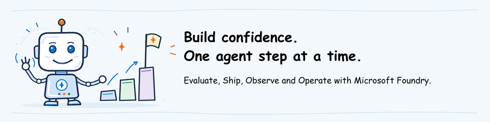

# AgentOps workshop labs

**Start with [participant pre-work](../pre-work/README.md), then open the lab
selected in your invitation.** Teaching the workshop? Start with the
[instructor guide](../instructor-guide/README.md) instead.

## Follow the workshop sequence

| Order | Open this lab | What you will work on |
| --- | --- | --- |
| 1 | [Evaluate](01-evaluate/lab.md) | 60 minutes: compare exact agent versions using responses, tool actions and evaluation results |
| 2 | [Ship](02-ship/lab.md) | 75 to 90 minutes: build a release pipeline that evaluates, waits for approval and releases your own agent |
| 3 | [Observe and Operate](03-observe-operate/lab.md) | 60 minutes: investigate a complaint with traces, a scoped query and a fired alert, then decide the response |
| Optional | [Advanced](04-advanced/lab.md) | 150 minutes: add a regression test and automatic gates, then prove recovery from the same incident |

The folder numbers show the sequence for the full workshop. You can also
attend a single module: complete the common pre-work and that module's section.
Each lab's scenario explains what came before. Advanced continues your Ship work.

**Choose one Ship pipeline tool:** [GitHub Actions](02-ship/github-actions/README.md)
or [Azure Pipelines](02-ship/azure-pipelines/README.md). They are alternatives
within module 2, not two consecutive labs.

## Where is the agent built?

The instructor/admin prepares or reuses the Foundry environment and deploys
the help desk agent **before the workshop**. Participants do not create a
separate environment. In Ship, each participant's pipeline deploys their own
copy of the agent to the same project.
The [technical setup](../pre-work/technical-setup.md) links to
environment setup and agent deployment.

The unnumbered [`shared`](shared/) folder holds reusable code and files.
Its [help desk agent](shared/helpdesk-agent/README.md) supports the labs;
it is not a preliminary participant lab.

## Find the other workshop materials

The [folder map](../../README.md#folder-map) describes where each type of
material is stored. Use it to find the workshop one-pager, decks,
instructor guidance and implementation guidance.
Preparation stays in pre-work; the numbered labs explain what to do
during the selected activity.
