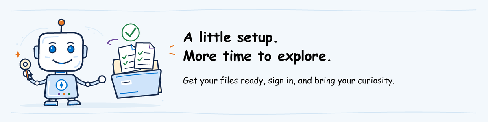

# AgentOps workshop: participant pre-work



Let's get your computer ready so you can focus on the agent during the workshop.
Complete the common preparation, then only the sections for your modules.

**Watching a demo?** Just read the invitation; no other pre-work is needed.
Instructors start with [their own guide](../instructor-guide/README.md).

After preparation, return to the [numbered labs](../labs/README.md):
Evaluate, Ship, then Observe and Operate. Complete only the modules selected
for your session; Advanced is optional.

**On this page**

- [Common preparation](#common-preparation)
- [Evaluate](#evaluate)
- [Ship](#ship)
- [Observe and Operate](#observe-and-operate)
- [Advanced (optional)](#advanced-optional)
- [Ready for the workshop?](#ready-for-the-workshop)
- [Keep your files for the next activity](#keep-your-files-for-the-next-activity)

## Common preparation

### Open the invitation

1. Open the **AgentOps workshop** calendar invitation. Its settings sections
   show which modules you will take.
2. Open the invitation's **Foundry project** link and sign in with the account it names.
   Follow **Network access** if a VPN connection is required.

Every hands-on module starts from the course repository and the AgentOps
Accelerator CLI, prepared once below. Then each module adds a few values from
the invitation:

| Continue with | What you need from the invitation | What you will do |
| --- | --- | --- |
| [Evaluate](#evaluate) | **Evaluate settings** | Evaluate two agent versions in the shared project |
| [Ship](#ship) | **Ship settings** | Build a release pipeline and release your own agent |
| [Observe and Operate](#observe-and-operate) | **Observe settings** | Investigate a complaint with traces, a query and an alert |
| [Advanced](#advanced-optional) | Nothing new: your Ship branch | Add a regression test and an automatic gate, then recover from a bad release |

**Can't open a link?** Reply to the invitation's organizer before the session.
They will arrange access.

### Use a prepared machine, or install only missing tools

**Every hands-on module needs Git, Python 3.11 and Azure CLI.**
Skip installation if the instructor provides a prepared machine.

To check an existing installation, open **Start**, type **PowerShell**, and
press Enter. Run each command below. Install only the tool whose expected
output is missing or whose command is not recognized.

| Tool | Install if missing | Run and look for |
| --- | --- | --- |
| Git | Run the [Git for Windows installer](https://git-scm.com/download/win), then reopen PowerShell | `git --version` prints `git version` |
| Python 3.11 | Install the [Python install manager for Windows](https://www.python.org/downloads/windows/), then run `pymanager install 3.11` | `py -3.11 --version` prints `Python 3.11.x` |
| Azure CLI | Run the [official Windows installer](https://aka.ms/installazurecliwindowsx64), then reopen PowerShell | `az version` prints version details containing `azure-cli` |

VS Code is a convenient editor, **not a requirement**. Use
[VS Code](https://code.visualstudio.com/download) or an editor you already have.
**No VS Code extension, Foundry Toolkit or azd is needed on your machine.**
The labs use VS Code menu names; other editors can open the same files.

If installation is blocked, contact the instructor for an approved machine.

### Get the lab files

The course files are in the [placerda/AzureAIGovernance](https://github.com/placerda/AzureAIGovernance)
repository on GitHub: lab instructions, the sample agent's code, test requests
and evaluation settings. Open **Start > PowerShell** and run:

**What this block does:** downloads the course repository to Documents\AgentOps-workshop.

```powershell
$Root = Join-Path ([Environment]::GetFolderPath('MyDocuments')) 'AgentOps-workshop'
New-Item -ItemType Directory -Force $Root | Out-Null
git clone https://github.com/placerda/AzureAIGovernance.git (Join-Path $Root 'AzureAIGovernance')
if ($LASTEXITCODE -ne 0) { throw 'Download failed. Contact the instructor.' }
```

This creates **Documents > AgentOps-workshop > AzureAIGovernance**. Instructions
call this folder the **repository root**. If it already exists from an earlier
attempt, keep it and continue.

On a prepared machine, this folder is already in place; skip this block.

### Sign in to the assigned account

**Why sign in here:** the labs use your permission to work in the workshop's
Azure project. Signing in to the browser alone does not sign in PowerShell.

Open **Start > PowerShell** and run the block below.
Paste **Tenant ID** from the invitation when prompted. Azure CLI is the tool
you use to sign in from PowerShell; the tenant ID makes sure you sign in to the
organization that owns the workshop project.

**What this block does:** signs you in to the workshop's organization.

```powershell
$TenantId = Read-Host 'Tenant ID from the invitation'
az login --tenant $TenantId --allow-no-subscriptions --output none
if ($LASTEXITCODE -ne 0) { throw 'Sign-in failed. Contact the instructor.' }
az account show --query '{tenantId:tenantId,user:user.name}' --output table
if ($LASTEXITCODE -ne 0) { throw 'Cannot check the selected account.' }
```

**Check the selected account:**

1. Compare the output's `TenantId` with **Tenant ID** in the invitation.
2. Check that `User` is the invitation's **Sign-in account**.

If either differs, stop and send the instructor the output; do not continue
with another account.

<a id="1-participant-install-the-public-cli"></a>

### Install the AgentOps Accelerator CLI

**What this gives you:** the `agentops` command evaluates agents, generates
release pipelines and checks an agent's health. Every lab uses the copy you
install here.

In File Explorer, open `agentops\workshop\labs\01-evaluate` inside the repository.
Type `powershell` in its address bar and press Enter.
On a prepared machine, skip the installation block. Otherwise, run the complete
block:

**What this block does:** installs the AgentOps Accelerator CLI in its own Python environment.

```powershell
py -3.11 -m venv .venv
if ($LASTEXITCODE -ne 0) { throw 'Python environment creation failed. Contact the instructor.' }
.\.venv\Scripts\python.exe -m pip install -r .\requirements.txt
if ($LASTEXITCODE -ne 0) { throw 'Package installation failed. Contact the instructor.' }
.\.venv\Scripts\agentops.exe --version
if ($LASTEXITCODE -ne 0) { throw 'AgentOps Accelerator CLI unavailable. Contact the instructor.' }
```

**Check:** installation finishes and `agentops` prints its version.
The `.venv` folder keeps the tool's Python packages separate from other projects.
The labs use it directly; you do not need to activate it.

On every machine, including a prepared machine, run:

**What this block does:** checks that the prepared Python environment has no
broken or conflicting dependencies.

```powershell
.\.venv\Scripts\python.exe -m pip check
if ($LASTEXITCODE -ne 0) { throw 'Evaluation dependencies conflict. Contact the instructor.' }
.\.venv\Scripts\agentops.exe --version
if ($LASTEXITCODE -ne 0) { throw 'AgentOps Accelerator CLI unavailable. Contact the instructor.' }
```

**Expected result:** `pip check` prints `No broken requirements found`, and the
CLI prints its version.

**Package unavailable or version not found:** stop and send the error to the
instructor. They must provide access to the required packages or a prepared
machine. Do not select an older version or change your package source.

## Evaluate

You will use the class's shared Foundry project, where the instructor has
deployed two versions of the sample agent. During the lab you evaluate both
and compare the results.

**You do not create your own environment or deploy an agent.** Those steps are
in [instructor environment setup](foundry-environment.md) and
[help desk deployment](../labs/shared/helpdesk-agent/README.md).

<a id="2-participant-initialize-the-supported-evaluation-workspace"></a>

### Create your workspace

Run [lab step 1](../labs/01-evaluate/lab.md#1-create-the-workspace)
now and follow its **Check the displayed values** instructions. It asks for the
four values in the invitation's **Evaluate settings**. The lab calls the version
under review the **candidate**, the earlier version the **baseline**, and the
model deployment that grades the answers the **scoring model**. You do not
deploy any of them.

Creating the workspace does not run an evaluation.
Report mismatched values to the instructor.

**Ready for the session:** once the displayed values match the invitation,
your local setup is complete. Save the evaluation runs for the workshop.

## Ship

You will create your own release pipeline in the class repository and use it to
release your own copy of the help desk agent. The instructor has already set up
the repository, its Azure sign-in and its approval step.

1. **Tell Git who you are.** Your commits carry this name. Run the block once.

   **What this block does:** sets the name and email on your commits. Local only.

   ```powershell
   git config --global user.name "Your Name"
   git config --global user.email "you@example.com"
   ```

2. **Open the class repository.** Open **Class repository** from the invitation
   in the browser and sign in. You should see the repository files, including
   `azure.yaml` and `agentops.yaml`. Git asks for the same sign-in the first
   time you clone, in lab step 1.
3. **Open your pipeline tool's instructions.** Open the **Pipeline tool** link
   from the invitation (GitHub Actions or Azure Pipelines). You follow that page
   alongside the lab.

Do not create a branch or run a pipeline during pre-work.

## Observe and Operate

You will investigate the released help desk agent with its traces, a log query
and an alert. You need the sign-in and the CLI from
[Common preparation](#common-preparation), nothing else to install.

1. Open **Foundry project** from the invitation and select **Agents**. You
   should see the agent and released version from your Ship lab, or **Agent to
   observe if you skip Ship** and **Agent version if you skip Ship**.
2. In the [Azure portal](https://portal.azure.com), search for the
   **Application Insights resource** named in **Observe settings** and open it.
   Select **Logs**; the query editor should open without an access error.

If either page is denied, send the link to the instructor.

## Advanced (optional)

Advanced continues your Ship branch and pipeline. Finish the
[Ship](../labs/02-ship/lab.md) and [Observe and Operate](../labs/03-observe-operate/lab.md)
labs first; there is nothing else to prepare.

<a id="readiness-gate"></a>

## Ready for the workshop?

You are ready when the links in the invitation open with your sign-in account,
the AgentOps Accelerator CLI prints its version and each module you run has its pre-work done. For
Evaluate, your workspace shows the values from the invitation.

<a id="retention-and-cleanup"></a>

## Keep your files for the next activity

Keep your files, branch and agents until the invitation's **Keep your work until** date.
Participants do not delete cloud resources.

<a id="instructoradmin-prepare-the-evaluation-workspace"></a>
<a id="instructoradmin-package-and-rehearse-the-learner-bundle"></a>

Instructors prepare the class with the [technical setup](technical-setup.md).
