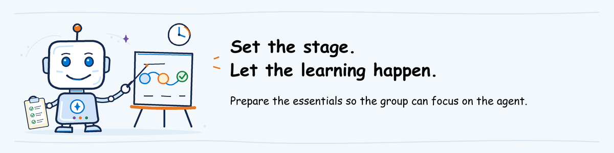

# Prepare the Foundry environment



**INSTRUCTOR/ADMIN.** Complete this once, before
[deploying the help desk agent](../labs/shared/helpdesk-agent/README.md).
Participants do not follow this guide.

**One environment for the class:** the instructor prepares one Foundry project,
shared by all participants, with two model deployments and the baseline and
candidate versions of the help desk agent. Each participant signs in with their
own account and runs their own evaluation against the same candidate.
Evaluation results and traces are stored in the shared project, not isolated
by participant.

**What you are preparing:** a Microsoft Foundry project, two model deployments
and monitoring. The agent will use one model to answer requests; evaluation
will use the other to score those answers. A project alone does not deploy the
help desk agent.

Complete steps **A and B** of
[instructor machine preparation](technical-setup.md#1-prepare-the-instructor-machine) first.
The administrator needs permission to create resources and assign roles in the
workshop resource group, such as **Owner** on that group. Do not give participants
Owner access.

**Before you start:** the workshop organizer confirms the subscription, resource group,
region, model capacity and retention date. Use only the supplied fictional data.
This portal route uses basic project settings; if policy requires a private
network, have the administrator supply a compliant project and connection
instructions. Do not disable network restrictions to follow the course.

**On this page**

- [1. Create or reuse the project](#1-create-or-reuse-the-project)
- [2. Deploy the two models](#2-deploy-the-two-models)
- [3. Connect monitoring](#3-connect-monitoring)
- [4. Give people access](#4-give-people-access)
- [5. Copy the project values and sign in](#5-copy-the-project-values-and-sign-in)

## 1. Create or reuse the project

### Have a workshop resource group ready

A **resource group** holds the Azure resources the owner will manage together.
Use an existing, approved workshop resource group.
If none exists, the subscription administrator follows these steps:

1. In [Azure portal](https://portal.azure.com), open **Resource groups > Create**.
2. Select the approved subscription and enter `rg-agentops-YYYYMMDD-initials`.
3. Choose the approved region, then **Review + create > Create**.
4. Open the group and give the setup administrator **Owner** on this group using the [IAM steps below](#assign-resource-access-in-azure-portal).

Use the workshop date and initials in the name. This creates the container for
the resources, not a Foundry project. Keep permission scoped to this group.

### Create a new workshop project

**Why this step:** the project is where Foundry will run the agent and keep
evaluations. Creating it also creates its parent Foundry resource.

1. Open [Microsoft Foundry](https://ai.azure.com) and sign in with the approved account.
2. Turn on **New Foundry** if the portal offers that switch.
3. Open the project selector at the upper left and select **Create new project**.
4. Enter `agentops-YYYYMMDD-initials`, using your workshop date and initials.
5. Open **Advanced options** and select the approved subscription and resource group.
6. Select **East US 2** if the owner approved that region, then select **Create**.

East US 2 supports hosted agents and cloud batch evaluation; it does not
guarantee model capacity. If it is unavailable or prohibited, stop and have the
administrator select a region in both the
[hosted-agent list](https://learn.microsoft.com/azure/foundry/agents/concepts/hosted-agents#supported-regions)
and [evaluation list](https://learn.microsoft.com/azure/foundry/concepts/evaluation-regions-limits-virtual-network).

**Expected:** resource creation completes and the new project's **Home** opens.
For a failed creation, retain the error and ask the administrator to resolve it;
do not create several replacement projects.

### Reuse an existing Foundry project

1. Open its owner-approved browser link and compare the project name with the owner's assignment.
2. Open **Home** and find the project endpoint.
3. Continue with the model, monitoring and access steps below, reusing matching resources.

The endpoint must have the form
`https://RESOURCE.services.ai.azure.com/api/projects/PROJECT`.
An Azure OpenAI endpoint or Azure Machine Learning workspace alone is not
a Foundry project, so it cannot be used here.

See [Create a Foundry project](https://learn.microsoft.com/azure/foundry/how-to/create-projects)
for the portal creation reference.

## 2. Deploy the two models

**ADMIN. Why two deployments:** keep the model answering requests separate
from the model grading them. These are model deployments, not agent versions.

| Purpose | Model to select | Deployment name |
| --- | --- | --- |
| Help desk answers and function calls | `gpt-5.4-mini` | `agentops-agent` |
| Coherence and similarity scores | `gpt-5-mini` | `agentops-eval` |

The agent choice follows the
[official Responses tools sample](https://github.com/microsoft-foundry/foundry-samples/blob/main/samples/python/hosted-agents/agent-framework/responses/02-tools/azure.yaml).
The scoring choice follows [Foundry's judge guidance](https://learn.microsoft.com/azure/foundry/concepts/evaluation-evaluators/general-purpose-evaluators).
Similarity uses a judge here, not an embedding model.

For each row in the table:

1. In Foundry, open **Discover > Models** and search for the model name.
2. Open its card, then select **Deploy > Custom settings**.
3. Enter the deployment name from the table.
4. Select **Global Standard**, only if the owner approves global processing.
5. Have the owner approve the displayed model version and capacity, then select **Deploy**.
6. Open **Build > Models** and wait for the deployment to show **Succeeded**.

Do not choose **Batch**. If the model, approved deployment type or quota is
unavailable, send the displayed error to the administrator before continuing.
Do not silently substitute a model; the instructor must rehearse the selected
agent and judge together.

**Reusing deployments?** Open each in **Build > Models**. Confirm its underlying
model, version and successful status. Keep its actual deployment name for step 5;
it does not have to be renamed to match the examples.

**Expected:** both deployments appear in **Build > Models**. Save their names
and model versions with the instructor's files.
See [model deployment instructions](https://learn.microsoft.com/azure/foundry/foundry-models/how-to/deploy-foundry-models)
for quota and deployment details.

## 3. Connect monitoring

**Why this step:** learners must see what the tools actually did, not just the
agent's final answer. Application Insights stores the execution records;
its Log Analytics workspace stores the underlying telemetry.

1. In the project, select **Agents** in the left navigation, then **Traces**.
2. Select **Connect** and choose the owner's existing Application Insights resource.
3. Select **Connect** again and wait for the success message.

**No Application Insights resource yet?**

1. Open [Azure portal](https://portal.azure.com), search for **Application Insights**, then select **Create**.
2. Select the approved subscription, workshop resource group and region.
3. Enter `appi-agentops-YYYYMMDD-initials`, using the same date and initials.
4. Select the approved Log Analytics workspace, or keep the automatic new-workspace selection if its creation is approved.
5. Select **Review + create**, then **Create**; wait for deployment to complete.
6. Return to Foundry **Agents > Traces > Connect** and connect that resource.

After creation, open Application Insights **Overview** and follow its
**Workspace** link. Keep that workspace name for the access assignments below.
When no existing workspace is selected, Azure creates one automatically;
see [Application Insights creation](https://learn.microsoft.com/azure/azure-monitor/app/create-workspace-resource).

**Already connected, or no Connect button?** Open **Manage > Project details >
Connected resources**. Locate the Application Insights connection and compare
its resource with the one the owner approved. If missing, select **Add connection >
Application Insights** and connect it.

**Expected:** the connection is listed. The trace list can still be empty:
the help desk agent has not been deployed or invoked yet.
For a connection error, stop and give the administrator the resource name and error.

The [hosting library exports telemetry automatically](https://learn.microsoft.com/azure/foundry/agents/how-to/configure-hosted-agent-telemetry)
when monitoring is connected. Do not add another exporter or paste an Application
Insights connection string into the agent configuration.
[Agent deployment](../labs/shared/helpdesk-agent/README.md#2-deploy-and-test-the-baseline)
enables the tool-content capture required by this fictional exercise.

## 4. Give people access

**ADMIN. Why this step:** the instructor deploys agents, participants submit
evaluations, and both need to read results. Permission to open the project
does not automatically grant permission to read its telemetry.

### Assign project access in Foundry

1. Open **Manage > Project details > Users > Add user**.
2. Add the instructor with **Foundry Project Manager**.
3. Add the attendees, or their approved class group, with **Foundry User**.
   Also create a test account for the instructor with only the attendee roles
   in this step, so the instructor can rehearse with participant permissions.
4. Return to **Users** and confirm those names and roles appear.

Some screens still show the previous **Azure AI** role names. Their role IDs
are unchanged. See [Foundry roles](https://learn.microsoft.com/azure/foundry/concepts/rbac-foundry).

### Assign resource access in Azure portal

Open the parent resource through Foundry **Manage > Project details**:
select the parent resource, then **Open in Azure portal**.
For monitoring resources, use Azure portal search and select the exact names
created or connected in step 3.

| Assign to | Role | Open this resource |
| --- | --- | --- |
| Instructor and attendees | Reader | Parent Foundry resource |
| Person deploying the models, if not already authorized | Contributor | Parent Foundry resource |
| Instructor and attendees inspecting traces | Monitoring Reader | Connected Application Insights |
| Instructor and attendees reading protected prompts, responses and tool content | Privileged Monitoring Data Reader | Connected Application Insights |
| Instructor and attendees querying trace logs | Log Analytics Reader | Its Log Analytics workspace |
| Attendees creating their own alert in Observe and Operate (optional) | Monitoring Contributor | Workshop resource group |

For each required assignment:

1. Open **Access control (IAM) > Check access** and search for the person or class group.
2. If the role is absent, select **Add > Add role assignment** and choose the role.
3. Under **Members**, select **User, group, or service principal**, then **Select members**.
4. Select the approved person/group and finish with **Review + assign**.

Existing equivalent or inherited permissions need no duplicate assignment.
If **Add role assignment** is disabled, the resource's access administrator
must perform it. Do not broaden access to the subscription to clear an error.
The workshop reads tool arguments and results from the protected
`AppGenAIContent` table. Keep its protection enabled and grant
**Privileged Monitoring Data Reader** only to the approved class group and
instructor. Do not remove protection to clear an access error.

### Let the project use its models

The **project managed identity** is the project's Azure account, not the
instructor or the agent. Foundry uses it to access the parent resource's models,
including the scoring model.

1. On the **parent Foundry resource**, open **Access control (IAM) > Role assignments**.
2. Find the workshop project's managed identity and look for **Foundry User**.
3. If absent, select **Add role assignment > Foundry User**.
4. Under **Members**, choose **Managed identity > Select members** and select the workshop project's identity.
5. Finish with **Review + assign**.

Select the **project's** identity, not the parent resource's similarly named
identity. Portal project creation can add this assignment automatically;
the role list must still show it.

The help desk agent uses the project endpoint and local simulated tools.
Its own agent identity receives the default access for that path; do not
create an application registration or give it Owner.
See [hosted-agent permissions](https://learn.microsoft.com/azure/foundry/agents/concepts/hosted-agent-permissions).

## 5. Copy the project values and sign in

**INSTRUCTOR. Why this step:** deployment needs the Azure resource identifier;
evaluation needs the HTTPS project endpoint. They are different values.
Signing in to the browser does not sign in either command-line tool.

Collect these values from the existing screens, not from an example:

| Value | Where to copy it |
| --- | --- |
| Tenant ID | Azure portal > Microsoft Entra ID > Overview > Tenant ID |
| Subscription ID and resource group | Parent Foundry resource > Overview |
| Parent resource name | Title of that Foundry resource in Azure portal |
| Project name and endpoint | Foundry project > Home |
| Agent and scoring deployment names | Foundry > Build > Models |

In the PowerShell window from machine preparation, sign in:

**What this block does:** signs you in to Azure and selects the subscription.

```powershell
$TenantId = Read-Host 'Tenant ID from Microsoft Entra ID'
$SubscriptionId = Read-Host 'Subscription ID from the Foundry resource'
az login --tenant $TenantId --output none
if ($LASTEXITCODE -ne 0) { throw 'Azure CLI sign-in failed.' }
az account set --subscription $SubscriptionId
if ($LASTEXITCODE -ne 0) { throw 'Approved subscription unavailable.' }
az account show --query '{tenantId:tenantId,id:id,name:name}' --output table
if ($LASTEXITCODE -ne 0) { throw 'Cannot inspect the selected account.' }
```

Compare `TenantId` and `Id` with the two copied IDs. Stop if either differs.
Then sign in to the deployment tool with the same account:

**What this block does:** signs the Azure Developer CLI in with the same account.

```powershell
azd auth login --tenant-id $TenantId
if ($LASTEXITCODE -ne 0) { throw 'Azure Developer CLI sign-in failed.' }
```

**What this block does:** looks up the project's resource ID and endpoint. Read-only.

```powershell
$ResourceGroup = Read-Host 'Resource group from the Foundry resource Overview'
$FoundryResource = Read-Host 'Parent Foundry resource name'
$ProjectName = Read-Host 'Project name from Foundry Home'
$ProjectEndpoint = (Read-Host 'Project endpoint from Foundry Home').Trim().TrimEnd('/')
$ModelDeployment = Read-Host 'Agent model deployment name (normally agentops-agent)'
$JudgeDeployment = Read-Host 'Scoring deployment name (normally agentops-eval)'
$ProjectResourcePath = "/subscriptions/$SubscriptionId/resourceGroups/$ResourceGroup/providers/Microsoft.CognitiveServices/accounts/$FoundryResource/projects/$ProjectName"
$ProjectId = az resource show --ids $ProjectResourcePath --query id --output tsv
if ($LASTEXITCODE -ne 0 -or -not $ProjectId) { throw 'Project lookup failed. Check the names and account with the administrator.' }
"Project resource ID: $ProjectId"
"Project endpoint: $ProjectEndpoint"
```

The resource ID must start with `/subscriptions/` and end with
`/accounts/RESOURCE/projects/PROJECT`, matching your selected resource and project.
The endpoint must be the `/api/projects/PROJECT` URL from **Home**, not a browser
address or Azure OpenAI endpoint.
The [resource lookup command](https://learn.microsoft.com/cli/azure/resource#az-resource-show)
must return the existing project; constructing its path is not proof that it exists.

Keep the window open for deployment. If it closes, repeat the
[machine guide's folder block](technical-setup.md#a-download-the-workshop-source-and-open-powershell)
and this section; neither recreates resources.
Keep the project browser link, names and model versions with the instructor's files,
not in the public repository.

**Next:** [deploy and test the baseline and candidate](../labs/shared/helpdesk-agent/README.md).
The environment is prepared, but the help desk agent is not installed yet.
The later [participant rehearsal](technical-setup.md#try-one-evaluation-with-participant-permissions)
must demonstrate that the deployed agent and scoring model work together.
